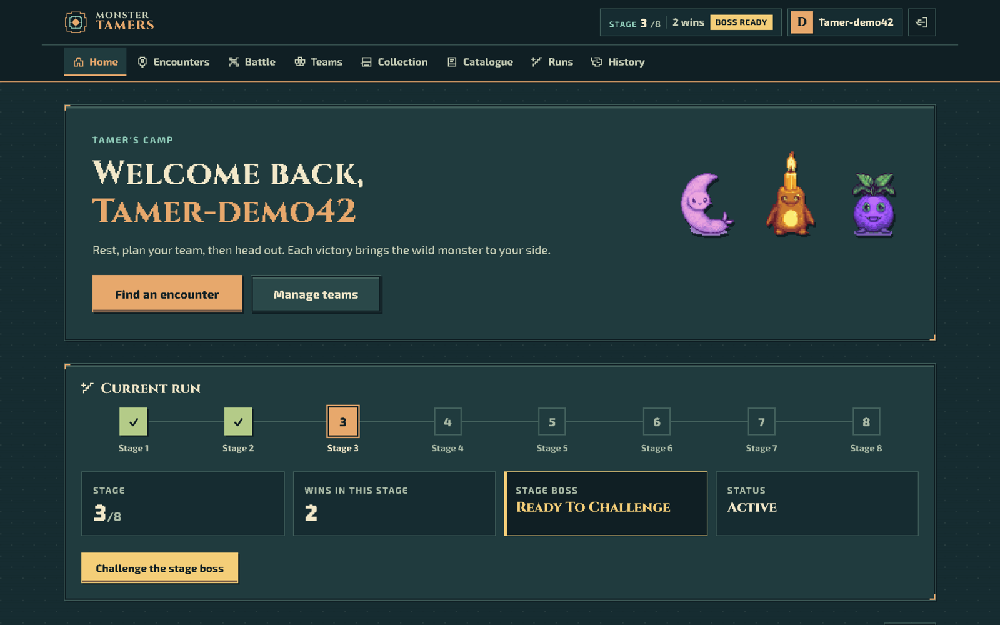
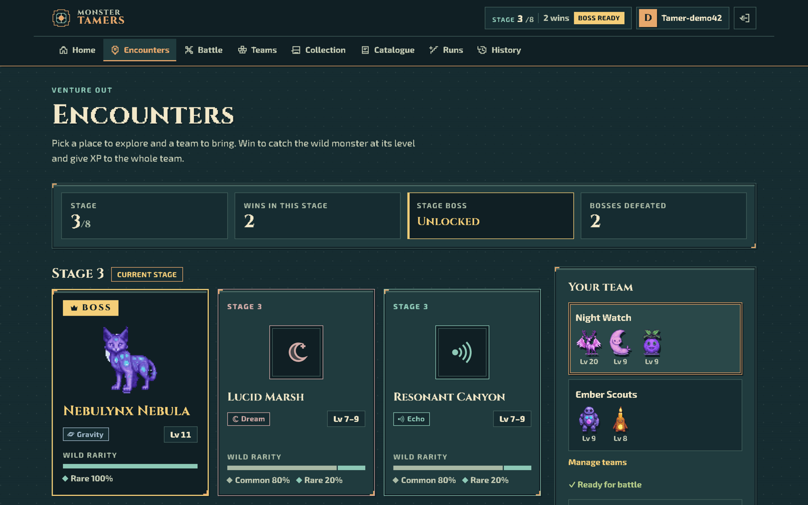
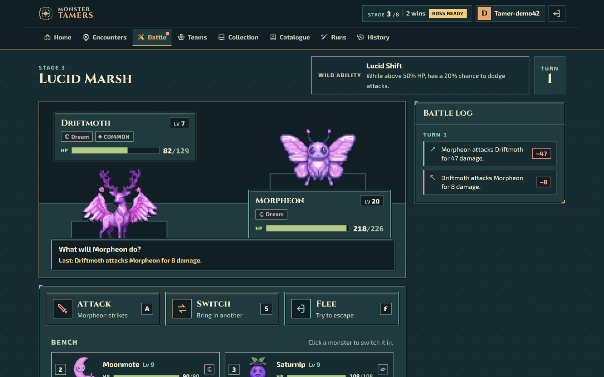
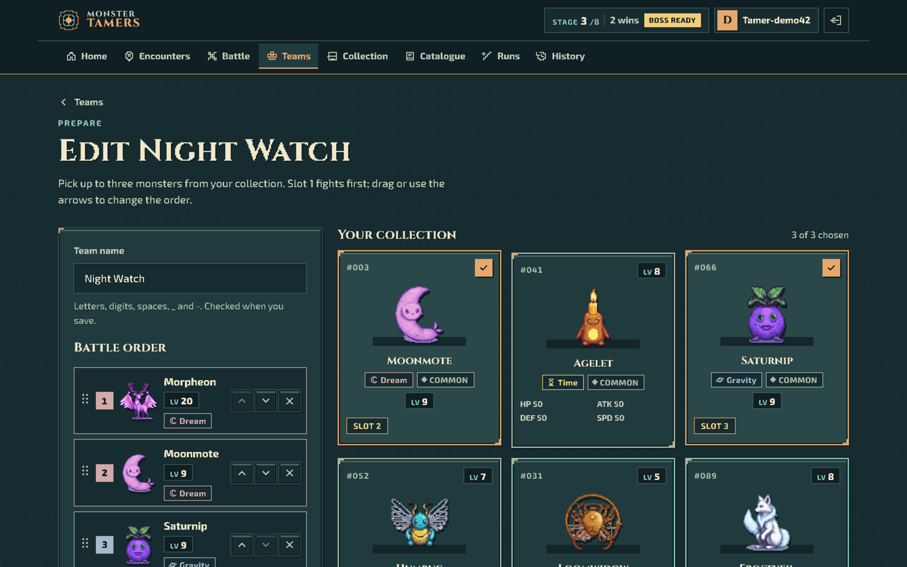
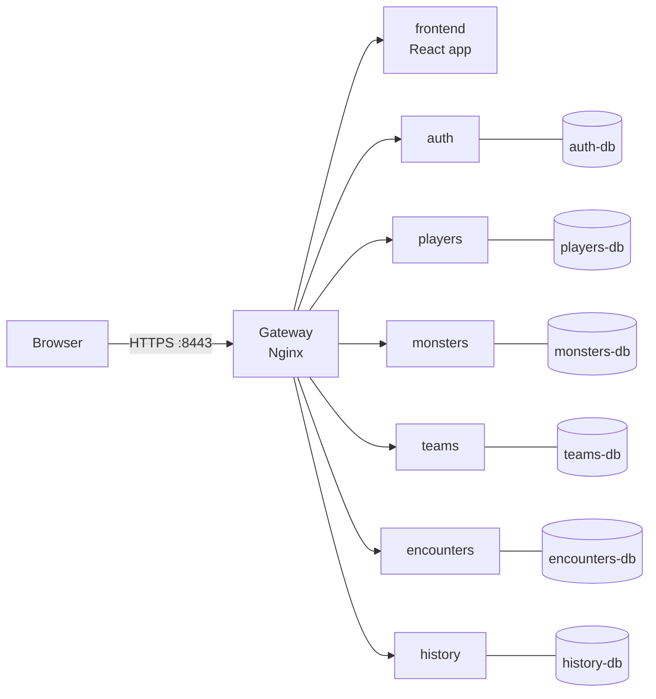

# Monster Tamers

[](https://github.com/fabiopsh/ASE-Tamer-Project/actions/workflows/ci.yml)

A roguelike monster-taming browser game built on microservices.
Advanced Software Engineering lab project, University of Pisa, A.Y. 2026/27.

## Quick start

You only need **Docker** (Docker Desktop, or Engine ≥ 26 with Compose ≥ 2.30).

```bash
git clone https://github.com/fabiopsh/ASE-Tamer-Project.git
cd ASE-Tamer-Project
docker compose up -d --build --wait
```

Open **https://localhost:8443** and create an account.

The first build takes a few minutes, later starts take about 30 seconds. The certificate comes from a CA that is generated locally, so the browser warns once: choose *Advanced → Proceed*. To skip the warning, export the CA with `scripts/export-ca.sh` and add `tamer-ca.crt` to your trusted authorities.

```bash
docker compose down        # stop, keep your progress
docker compose down -v     # stop and delete all data and generated secrets
```

## Screenshots

| | |
|---|---|
|  |  |
| **Camp**: run progress across the 8 stages | **Encounters**: pick a place and a team |
|  |  |
| **Battle**: turn by turn, computed by the server | **Teams**: up to three monsters, in battle order |

## The game

1. Register and pick **3 starters** from a pool of 10.
2. Build a **team** of 1–3 monsters.
3. Choose an **encounter** in the current stage and fight with *Attack*, *Switch* or *Flee*.
4. When you win, the wild monster **joins your collection** and your team gains **XP**.
5. Two wins unlock the **stage boss**. Beat it to reach the next stage. There are 8 stages in all.
6. A defeat ends the **run**: you pick new starters and start again. Past runs and battles stay in your history.

The catalogue has 100 monsters across several elements and rarities, each with its own ability.

## What we built

- **Six microservices** (Quarkus, Java 21), one PostgreSQL database each.
- **One entry point**: an Nginx gateway serves both the web app and the API on `https://localhost:8443`.
- **Server-side battles**: the client only sends the chosen action. Rewards go through idempotent service-to-service calls with an outbox.
- **Security by default**: HTTPS on every hop, including the databases, with a local CA. OAuth2 tokens are JWTs (RS256), and every secret is generated at first start, so none is committed. Containers run as non-root with no capabilities, and login is rate-limited.
- **Web client**: React, TypeScript and Vite, with a custom pixel-art theme.
- **Quality**: unit and service tests, API tests (Bruno: component, integration, end-to-end), load tests (Locust), and CI with Semgrep and Trivy.

## Architecture



Only the gateway publishes a port. Everything else runs on an internal Docker network, and `/internal/*` endpoints are never routed.

| Service | Owns |
|---|---|
| `auth` | Accounts, passwords (bcrypt), OAuth2 token endpoint, JWT signing |
| `players` | Player profile, starter pool, current run |
| `monsters` | Catalogue, abilities, sprites, collections, levels and XP |
| `teams` | Teams and their validation |
| `encounters` | Runs, stages, encounters, battle engine |
| `history` | Permanent record of every finished battle |
| `frontend` | Static web app (served through the gateway) |

## Tests

```bash
mvn -f backend/pom.xml verify                     # unit and service tests (Java 21, Maven, Docker)
```

API tests (Bruno) and load tests (Locust) run against the test stack. See [docs/tests/bruno](docs/tests/bruno/README.md) and [docs/locust](docs/locust/README.md).

## More

| | |
|---|---|
| Architecture and game rules | [docs/architettura](docs/architettura/architettura_backend.md) |
| Implementation plan and decisions | [docs/plan](docs/plan/README.md) |
| OpenAPI specs | [docs/openapi](docs/openapi/) |
| Security analysis | [docs/security](docs/security/README.md) |
| Backlog and acceptance criteria | [docs/backlog](docs/backlog/acceptance_criteria.md) |
| Frontend development (hot reload, mock server) | [frontend/README.md](frontend/README.md) |

<details>
<summary>Troubleshooting</summary>

- **Port 8443 in use**: stop the other process, or change the gateway port in `docker-compose.yml`.
- **`volume subpath` not supported**: update Docker (Compose ≥ 2.30).
- **`init-secrets` exits with 255 on Windows**: scripts need LF line endings. Run `git add --renormalize .`.
- **Certificate errors after `down -v`**: the CA was regenerated. Export it again with `scripts/export-ca.sh`.
- **A service stays `unhealthy`**: check `docker compose logs <service>`.
- **`429 Too Many Requests` on login**: login and registration allow 10 requests per minute per IP.

</details>
