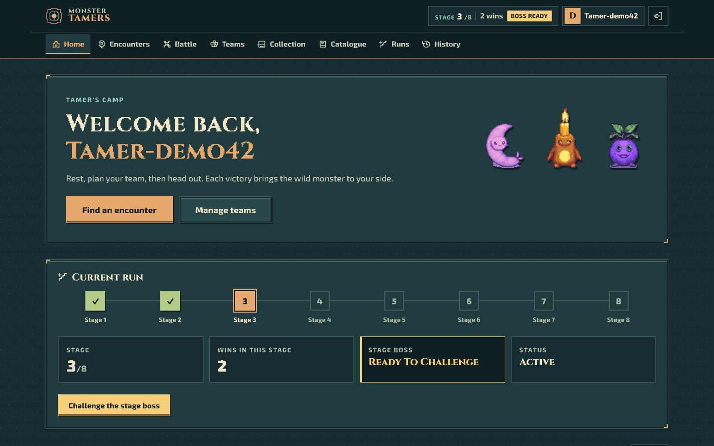
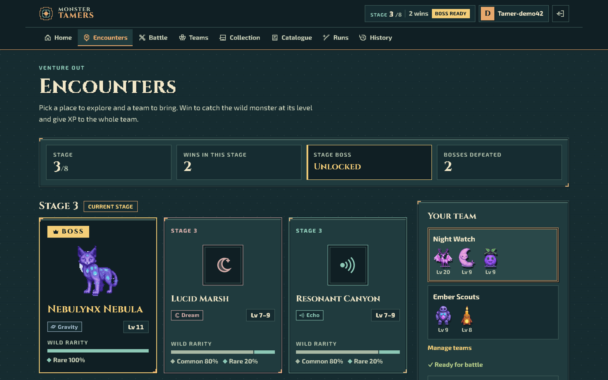
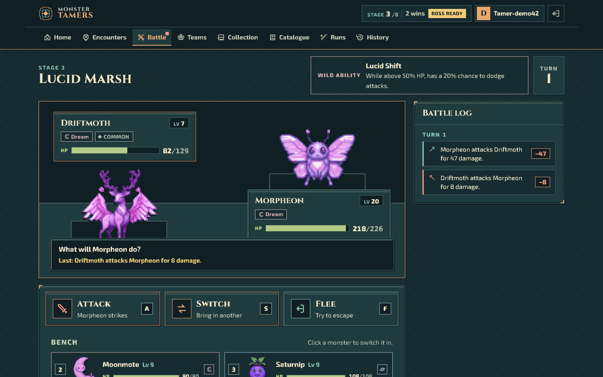
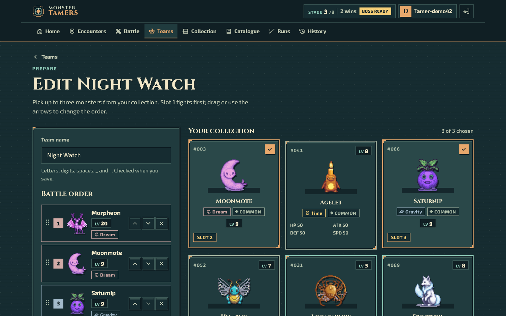
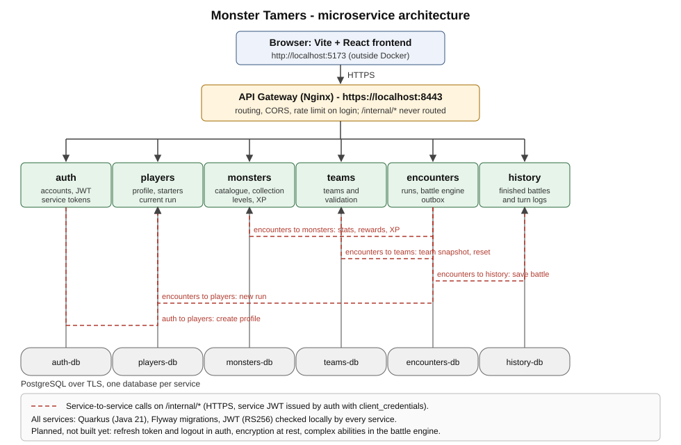

# Monster Tamers

[](https://github.com/fabiopsh/ASE-Tamer-Project/actions/workflows/ci.yml)

A roguelike monster-taming browser game built on microservices.
Advanced Software Engineering lab project, University of Pisa, A.Y. 2026/27.

## Group

**Fantastic 4**

| Name | Surname | Email |
|---|---|---|
| Giacomo | Cesaretti | giacomocesaretti03@gmail.com |
| Federico | Lombardi | f.lombardi26@studenti.unipi.it |
| Fabio | Piscitelli | f.piscitelli4@studenti.unipi.it |
| Francesco | Polperio | f.polperio@studenti.unipi.it |

Monster Tamers is a browser game built on microservices. A player registers, picks three starter monsters, builds a team and fights wild monsters and stage bosses in roguelike runs. Victories grant experience and new monsters for the collection.

## Quick start (Get Started)

### 1. Prerequisites

| Tool | Version | Needed for |
|---|---|---|
| Docker Engine + Docker Compose | Engine ≥ 26, Compose ≥ 2.30 | Running the backend and frontend containers (required) |
| Java and Maven | Java ≥ 21, Maven ≥ 3.9 | Running backend unit and service tests locally (optional: Docker builds inside Maven container) |
| Node.js | LTS (≥ 22) | Local frontend development, Vitest tests, and Bruno CLI |

### 2. Build and run the backend and frontend

```bash
git clone https://github.com/fabiopsh/ASE-Tamer-Project.git
cd ASE-Tamer-Project
docker compose up -d --build --wait                               # backend (API on https://localhost:8443)
docker compose -f docker-compose.frontend.yml up -d --build       # frontend (http://localhost:8080)
```

1. Open **https://localhost:8443/health** once and accept the certificate (*Advanced → Proceed*). It is signed by a CA generated locally on first start. To skip the browser warning, run `scripts/export-ca.sh` and add `tamer-ca.crt` to your trusted authorities.
2. Open **http://localhost:8080** and create an account.

The first build takes a few minutes; later starts take about 30 seconds.

### 3. Frontend local development (outside Docker)

```bash
cd frontend
npm ci
npm run dev                                # http://localhost:5173 (connects to https://localhost:8443)
```

For headless browsers or dev setups without OS trust for `tamer-ca.crt`, you can also proxy `/api` and `/images` over verified HTTPS via Vite:

```bash
scripts/export-ca.sh
cd frontend && NODE_EXTRA_CA_CERTS=../tamer-ca.crt VITE_GATEWAY_URL="" VITE_PROXY_TARGET=https://localhost:8443 npm run dev
```

### 4. Stop, reset, and database backups

```bash
docker compose -f docker-compose.frontend.yml down   # stop the frontend
docker compose down                                  # stop the backend, keep your progress
docker compose down -v                               # stop and delete all data and generated secrets
```

To back up any PostgreSQL database volume (protection against data loss, US-25):

```bash
mkdir -p backups
for svc in auth players monsters teams encounters history; do
  docker compose exec -T "${svc}-db" pg_dump -U "${svc}_app" -d "$svc" > "backups/${svc}.sql"
done
```

Restore into a running database container with:

```bash
docker compose exec -T history-db psql -U history_app -d history < backups/history.sql
```

## Screenshots

| | |
|---|---|
|  |  |
| **Camp**: run progress across the 8 stages | **Encounters**: pick a place and a team |
|  |  |
| **Battle**: turn by turn, computed by the server | **Teams**: up to three monsters, in battle order |

## The game

1. Register, optionally customize your **display name and avatar** (`/profile`), and pick **3 starters** from a pool of 10.
2. Inspect your collection and optionally give your monsters **custom nicknames**.
3. Build a **team** of 1–3 monsters (up to 5 saved teams per run).
4. Choose an **encounter** in the current stage and fight with *Attack*, *Switch* or *Flee*.
5. When you win, the wild monster **joins your collection** and your team gains **XP**.
6. Two wins unlock the **stage boss**. Beat all 8 stage bosses (ending with Stage 8 Boss *Omnivoid*) to win the run.
7. A defeat or abandon ends the **run**: your collection is archived, you pick new starters, and past runs and tamper-evident battle history remain inspectable.

The catalogue has 100 monsters across 7 elements and 3 rarities, with 28 distinct abilities (both P1 stat/dodge modifiers and P2 complex effects: `heal`, `reflect`, `stun`, `revive`, `random_boost`, `copy_ability`, `invert_advantage`).

## What we built

- **Six microservices** (Quarkus 3.39.5, Java 21), one isolated PostgreSQL 17 database each on its own internal Docker network.
- **Headless backend with defence-in-depth auth**: an Nginx gateway (`https://localhost:8443`) validates every protected request via private HTTPS `auth_request` (`GET /internal/auth/authorize`) against the single canonical [`backend/security/access-policy.json`](backend/security/access-policy.json) table (52 rules) before forwarding; every backend service independently verifies RS256 JWTs and the same policy.
- **Separate frontend stack**: React 19, TypeScript, Vite 8 with custom pixel-art theme, running in its own compose stack (`docker-compose.frontend.yml`, `http://localhost:8080`) or standalone via `npm run dev`, communicating exclusively via the gateway HTTPS API with CORS and HTTP `Content-Security-Policy`.
- **Server-side deterministic battle engine v2**: client sends only actions; all 28 abilities resolve server-side using `SplittableRandom`; end-of-battle rewards, XP and history go through idempotent service-to-service calls with a transactional outbox and a 1-minute `EncounterSweepScheduler`.
- **Tamper-evident battle history (US-25)**: PostgreSQL append-only trigger (`BEFORE UPDATE OR DELETE`) plus per-player SHA-256 hash chain verifiable at any time via `GET /api/history/verify` and in the UI.
- **Security by default**: HTTPS/TLS 1.2+ on every hop including Postgres (`pg_hba.conf` `hostssl`), local CA and secrets generated at first start, 300 s RS256 access tokens with rotating opaque refresh tokens + reuse family revocation + server logout, AES-256-GCM encrypted usernames with HMAC blind index, login backoff, rate limiting on auth and `/api/*`, JSON audit logs at gateway (with verified subject) and `auth`, `read_only: true` non-root containers with `cap_drop: ALL` and resource limits.
- **Quality & CI**: 273 backend JUnit/`@QuarkusTest` tests, 16 frontend Vitest tests, 399 Bruno API tests (component, integration, e2e, access security), Locust performance tests, `scripts/security-check.sh`, `scripts/check-audit-log.sh`, Semgrep SAST, Trivy (fs, image, config), and Dependabot.

## Architecture



In the backend only the gateway publishes a port (`127.0.0.1:8443`). Services communicate on the internal `backend` network, each database sits on its own dedicated internal network (`<svc>-db-net`), and `/internal/*` and `/q/*` endpoints are never routed by the gateway. Allowed browser origins are set with `CORS_ALLOWED_ORIGINS` on the gateway (default: `localhost` on ports `8080`, `5173`, `4173`).

### Services overview

| Component | Responsibility |
|---|---|
| `gateway` | Nginx HTTPS reverse proxy, TLS termination/re-encryption, CORS, rate limiting, `auth_request` authorization, JSON request audit log |
| `auth` | Accounts (AES-256-GCM usernames, bcrypt passwords, HMAC blind index, login backoff), OAuth2 `password`/`refresh_token`/`client_credentials`, `POST /api/auth/logout`, `GET /internal/auth/authorize`, RS256 JWT signing, JSON auth audit log |
| `players` | Player profile (`GET`/`PATCH /api/players/me`, avatar & display name), persistent starter pool, current run lifecycle |
| `monsters` | Catalogue (100 species, 28 abilities, 7 elements, sprites), personal collection, levels/XP, custom nicknames (`PATCH /api/collection/{owned_id}`) |
| `teams` | Teams of 1–3 monsters (max 5 per run), server-side validation, run reset |
| `encounters` | Roguelike runs, 8 stages (32 templates), deterministic battle engine v2, transactional outbox, `EncounterSweepScheduler` |
| `history` | Permanent append-only record of every finished battle with per-player SHA-256 hash chain and `GET /api/history/verify` |
| `frontend` | Static React web app (separate stack, talks only to the gateway via HTTPS + CORS) |

## Implementation status

Both **Phase 1 (prototype)** and **Phase 2 (final delivery, 15/12/2026)** are complete, including all mandatory red and yellow user stories plus 5 optional green stories (`US-04`, `US-07`, `US-13`, `US-21`, `US-22`):

- **Auth & Access Security (US-01, US-02, US-05):** 300 s RS256 access tokens, rotating opaque refresh tokens (7-day absolute family lifetime, reuse detection revoking whole family), server-side `POST /api/auth/logout`, AES-256-GCM encrypted usernames + HMAC blind index, 5-attempt/15-min login backoff, common-password denylist, canonical `backend/security/access-policy.json` (52 rules) enforced at both gateway (`auth_request`) and services, per-IP rate limits on auth and `/api/*`, JSON audit logs with verified `player_id`.
- **Core Game & Optional Stories (US-03, US-04, US-06, US-07, US-09..US-24, US-28):** Profile editing (`PATCH /api/players/me`), 10-starter pool and choice, 100-monster catalogue & sprites, personal collection with XP/leveling and nicknames (`PATCH /api/collection/{owned_id}`), validated teams, 8-stage roguelike runs, battle engine v2 with all 28 abilities, scheduled sweep (`EncounterSweepScheduler`), full web UI with auto-refresh and server logout.
- **Tamper-Evident History (US-25):** PostgreSQL `BEFORE UPDATE OR DELETE` append-only trigger, per-player SHA-256 hash chain, `GET /api/history/verify` API and UI verification badge.
- **Verification & Delivery:** 273 backend JUnit tests, 16 frontend Vitest tests, 399 Bruno API tests (including `access/` security matrix), Locust P2 benchmark (3,354 reqs, 0.00% failures), `check-audit-log.sh` (18/18), `security-check.sh` (47/47), CI (Semgrep, Trivy, Dependabot), full browser playthrough through Stage 8 Boss *Omnivoid*, and final PDF report in [`docs/report/`](docs/report/Monster_Tamers_Final_Report.pdf).

**Known limitation.** Active battles live in memory in `encounters` (decision R19): if `encounters` restarts, in-progress battles are safely closed as `interrupted` without reward and without losing the run. `encounters` is designed as a single instance.

## OpenAPI specifications

One OpenAPI file for the gateway (the public API, pruned of `/internal/*` paths and schemas) and one for each microservice, all in [`docs/openapi/`](docs/openapi/):

| Component | File |
|---|---|
| API Gateway (public API) | [`gateway.yaml`](docs/openapi/gateway.yaml) |
| auth | [`auth.yaml`](docs/openapi/auth.yaml) |
| players | [`players.yaml`](docs/openapi/players.yaml) |
| monsters | [`monsters.yaml`](docs/openapi/monsters.yaml) |
| teams | [`teams.yaml`](docs/openapi/teams.yaml) |
| encounters | [`encounters.yaml`](docs/openapi/encounters.yaml) |
| history | [`history.yaml`](docs/openapi/history.yaml) |

## Repository layout

```
backend/
  security/access-policy.json  Canonical 52-rule access policy packaged into every service
  auth/ players/ monsters/ teams/ encounters/ history/
gateway/                       Nginx reverse proxy, auth_request config, security headers
infra/
  init-secrets/                One-shot container generating CA, certs, JWT keys, DB & crypto keys
  postgres/                    Hardened PostgreSQL 17 image with hostssl-only pg_hba.conf
frontend/                      React + TypeScript + Vite web app (own Dockerfile & Vitest tests)
scripts/                       export-ca, test-env, export-openapi, scan-images, security-check, check-audit-log, check-policy-sync, build-backlog-xlsx
.github/                       CI workflow (copy in docs/ci/ci.yml) and dependabot.yml
docs/                          report (PDF), plan, architecture, backlog, OpenAPI, Bruno/JSON tests, Locust, security
THREAT_MODEL.md                Data flow diagram, assets, trust boundaries, STRIDE threats, audit log
docker-compose.yml             Headless backend (gateway, 6 services, 6 isolated DBs, init-secrets)
docker-compose.test.yml        Test override: exposes services on 127.0.0.1:9001-9006, raises rate limits
docker-compose.frontend.yml    Separate frontend container stack on 127.0.0.1:8080
.trivyignore                   Documented, expiring Trivy exceptions
```

## Testing instructions

### 1. Backend unit and service tests (273 tests)

Requires Java 21, Maven 3.9+, and Docker (Quarkus Dev Services starts a throw-away PostgreSQL):

```bash
scripts/check-policy-sync.sh
mvn -f backend/pom.xml verify
```

### 2. Frontend typecheck, lint, unit tests, and build (16 tests)

```bash
cd frontend
npm ci
npm run typecheck && npm run lint && npm test && npm run build
```

### 3. API tests with Bruno (399 tests)

```bash
docker compose -f docker-compose.yml -f docker-compose.test.yml up -d --build --wait
scripts/test-env.sh                        # copies the CA and the test client secret (gitignored, 0600)
cd docs/tests/bruno
npm ci                                     # Bruno CLI, pinned version
npm run test:component                     # each service on its own port (9001..9006)
npm run test:integration                   # public requests through the gateway (8443)
npm run test:e2e                           # core loop through the gateway
npm run test:access                        # access-security matrix + refresh/logout (component + gateway)
```

`npm test` runs all four. Exported Postman-compatible JSON collections live in [`docs/tests/json/`](docs/tests/json/) and are regenerated with `npm run export`. Details: [`docs/tests/bruno/README.md`](docs/tests/bruno/README.md).

### 4. Performance tests with Locust

Against the gateway only (test stack active):

```bash
pip install -r docs/locust/requirements.txt
CA_PATH=.test-secrets/ca.crt locust -f docs/locust/locustfile.py --host https://localhost:8443 \
    --headless -u 30 -r 5 -t 60s --csv docs/locust/results/run
```

Results and analysis: [`docs/locust/README.md`](docs/locust/README.md).

### 5. Security scans, audit log, and self-attack checks

```bash
scripts/check-audit-log.sh https://localhost:8443 .test-secrets/ca.crt
scripts/security-check.sh https://localhost:8443 .test-secrets/ca.crt
scripts/scan-images.sh
```

Details: [`docs/security/README.md`](docs/security/README.md) and [`THREAT_MODEL.md`](THREAT_MODEL.md).

## Documentation index

| Topic | Location |
|---|---|
| Final project report (PDF + LaTeX) | [`docs/report/Monster_Tamers_Final_Report.pdf`](docs/report/Monster_Tamers_Final_Report.pdf) |
| Architecture and game rules | [`docs/architettura/architettura_backend.md`](docs/architettura/architettura_backend.md) |
| Implementation plan and decision log | [`docs/plan/README.md`](docs/plan/README.md) |
| OpenAPI specifications | [`docs/openapi/`](docs/openapi/) |
| Completed backlog & acceptance criteria | [`docs/backlog/acceptance_criteria.md`](docs/backlog/acceptance_criteria.md), [`Monster_Tamers_Backlog_completed.xlsx`](docs/backlog/Monster_Tamers_Backlog_completed.xlsx) |
| Threat model (STRIDE, rated gaps, audit log) | [`THREAT_MODEL.md`](THREAT_MODEL.md) |
| Security scans and self-attack results | [`docs/security/README.md`](docs/security/README.md) |
| Bruno API tests | [`docs/tests/bruno/README.md`](docs/tests/bruno/README.md) |
| Locust performance results | [`docs/locust/README.md`](docs/locust/README.md) |
| Frontend development guide | [`frontend/README.md`](frontend/README.md) |

## Ports

| Port | Service | Bind | When |
|---|---|---|---|
| `8443` | API Gateway (HTTPS) | `127.0.0.1` | Always (`docker-compose.yml`) |
| `8080` | Frontend container (HTTP) | `127.0.0.1` | `docker-compose.frontend.yml` |
| `9001`–`9006` | `auth`, `players`, `monsters`, `teams`, `encounters`, `history` (HTTPS) | `127.0.0.1` | Only with `docker-compose.test.yml` |
| `5173` | Frontend Vite dev server | `localhost` | `npm run dev` |
| `4173` | Frontend Vite preview server | `localhost` | `npm run preview` |
| `8081`–`8086` | Services in `quarkus:dev` mode (HTTP, Dev Services DB) | `localhost` | Local Maven development |

## Troubleshooting

- **Port 8443 already in use**: stop the other process, or change the published port of `gateway` in `docker-compose.yml`.
- **Port 8080 already in use**: start the frontend with `FRONTEND_PORT=8081` and add `http://localhost:8081` to `CORS_ALLOWED_ORIGINS`.
- **The app says *Cannot reach the game server***: the backend is not running, or the certificate of `https://localhost:8443` was not accepted in this browser.
- **`volume subpath` not supported**: update Docker Desktop (Engine ≥ 26, Compose ≥ 2.30).
- **curl on Windows says `CRYPT_E_NO_REVOCATION_CHECK` / error 60**: add `--ssl-no-revoke` to the curl command.
- **`init-secrets` exits with 255 on Windows**: shell scripts must use LF line endings (`.gitattributes` enforces it; run `git add --renormalize .`).
- **Certificate errors after `down -v`**: the CA was regenerated; run `scripts/export-ca.sh` (or `scripts/test-env.sh`) again.
- **A service stays `unhealthy`**: inspect `docker compose logs <service>`. After schema or credential changes, reset with `docker compose down -v`.
- **`429 Too Many Requests`**: the gateway limits `/api/auth/{token,register,logout}` to `10r/m` (burst 5) and `/api/*` to `120r/m` (burst 60) per IP. `docker-compose.test.yml` raises both limits for automated testing.
