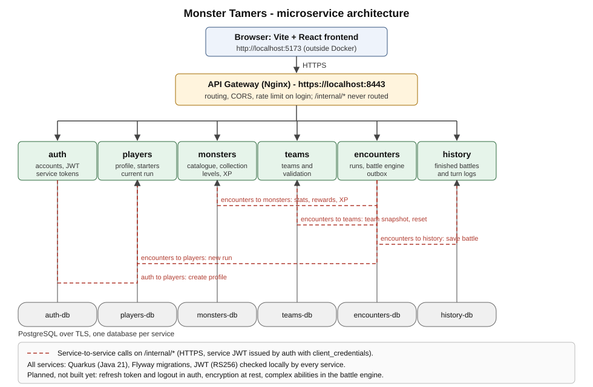

# Monster Tamers — ASE Lab Project

[](https://github.com/fabiopsh/ASE-Tamer-Project/actions/workflows/ci.yml)

Advanced Software Engineering lab project (University of Pisa, A.Y. 2026/27).

## Group

**Fantastic 4**

| Name | Surname | Email |
|---|---|---|
| Giacomo | Cesaretti | giacomocesaretti03@gmail.com |
| Federico | Lombardi | f.lombardi26@studenti.unipi.it |
| Fabio | Piscitelli | f.piscitelli4@studenti.unipi.it |
| Francesco | Polperio | f.polperio@studenti.unipi.it |

Monster Tamers is a browser game built on microservices. A player registers, picks three starter monsters, builds a team and fights wild monsters and stage bosses in roguelike runs. Victories grant experience and new monsters for the collection.

**Core loop.** Register and log in → choose 3 starters out of a pool of 10 common monsters → build a team of 1–3 monsters → pick an encounter of the current stage → fight turn by turn (`attack`, `switch`, `flee`) → on victory the wild monster joins the collection at its level and the team gains XP → after two wins the stage boss unlocks; beating it opens the next stage.

**Roguelike runs.** A run has 8 stages of growing difficulty. A defeat (or abandoning the run) ends it: the collection of that run is archived, teams are removed and the player chooses new starters for a new run. Past runs, their monsters and their battle history stay visible. Beating the stage 8 boss wins the run.

**Fair play.** The server computes every battle: the client only sends the chosen action. Rewards and XP are granted by internal service-to-service calls, which are idempotent, and every finished battle is stored in the history with its full turn log.

| Service | Responsibility |
|---|---|
| `auth` | Accounts, passwords (bcrypt), OAuth2 token endpoint, JWT signing, service clients |
| `players` | Game profile, starter pool, pointer to the current run |
| `monsters` | Catalogue of 100 monsters, abilities, sprites, personal collections, levels and XP |
| `teams` | Teams and their validation (size, ownership, run, limit of five) |
| `encounters` | Runs and stages, encounter templates, battle engine, end-of-battle outbox |
| `history` | Permanent record of every finished battle |

## Architecture



The diagram shows the planned architecture. All six services and the gateway are built; the features still missing are listed in [Implementation status](#implementation-status). A more detailed description (components, game rules, decisions) is in [`docs/architettura/architettura_backend.md`](docs/architettura/architettura_backend.md).

- Six Quarkus (Java 21) services, one PostgreSQL database each, schema managed by Flyway.
- Nginx is the only entry point (`https://localhost:8443`). Internal endpoints (`/internal/*`) are never routed.
- HTTPS on every hop with a local CA. Certificates, JWT keys and passwords are generated at first start, so no secret is committed.
- OAuth2 token endpoint and JWT (RS256), checked locally by every service.

## OpenAPI specifications

One OpenAPI file for the gateway (the public API, the one a client uses) and one for each microservice, all in [`docs/openapi/`](docs/openapi/):

| Component | File |
|---|---|
| API Gateway (public API) | [`gateway.yaml`](docs/openapi/gateway.yaml) |
| auth | [`auth.yaml`](docs/openapi/auth.yaml) |
| players | [`players.yaml`](docs/openapi/players.yaml) |
| monsters | [`monsters.yaml`](docs/openapi/monsters.yaml) |
| teams | [`teams.yaml`](docs/openapi/teams.yaml) |
| encounters | [`encounters.yaml`](docs/openapi/encounters.yaml) |
| history | [`history.yaml`](docs/openapi/history.yaml) |

## Implementation status

Phase 1 (prototype) is complete. Phase 2 (final delivery, 15/12/2026) is in progress.

**Working**
- Registration and login (OAuth2 password grant, JWT RS256), service-to-service tokens (`client_credentials`).
- Player profile, pool of 10 starters, choice of 3 starters at the start of each run.
- Catalogue of 100 monsters with sprites, abilities and elements; personal collection with levels and XP.
- Teams of 1–3 monsters with server-side validation (ownership, run, limit of five).
- Roguelike runs with 8 stages, wild encounters, stage bosses, abandon and defeat reset.
- Turn-based battle engine on the server (`attack`, `switch`, `flee`), elemental chart, simple abilities, rewards and XP through idempotent internal calls (outbox).
- History of every finished battle with the full turn log.
- HTTPS on every hop (local CA), a database per service, secrets generated at first start.
- Web UI covering the whole core loop: login, starters, catalogue, collection, teams, encounters, battle, runs, history.
- Tests: unit and service tests per service, Bruno API tests (component, integration, end-to-end), Locust load tests, CI with build, tests, Semgrep and Trivy.

**Still missing (planned for Phase 2)**
- Refresh token and logout (only the password grant exists).
- Encryption at rest (encrypted username, hashed refresh tokens).
- Complex abilities in the battle engine (`heal`, `reflect`, `stun` and similar are placeholders without effect).
- Scheduled sweep of expired battles and a more robust reset saga (today recovery is lazy: it happens when the player next touches the run).
- Integrity checks on the history (US-25).
- Optional stories: profile editing (US-04) and monster nicknames (US-13).

**Known limit.** If `encounters` restarts, battles in progress are closed as `interrupted` without reward and without losing the run. The service cannot be replicated on several instances.

## Additional information

Documents:

| What | Where |
|---|---|
| Implementation plan and decision log (the reference for development) | [`docs/plan/`](docs/plan/README.md) |
| Architecture and game rules | [`docs/architettura/architettura_backend.md`](docs/architettura/architettura_backend.md) |
| OpenAPI: gateway (public API) and every service | [`docs/openapi/`](docs/openapi/) |
| Backlog with acceptance criteria, dependencies and tests | [`docs/backlog/acceptance_criteria.md`](docs/backlog/acceptance_criteria.md), [`Monster_Tamers_Backlog_completed.xlsx`](docs/backlog/Monster_Tamers_Backlog_completed.xlsx) |
| API tests: Bruno sources and exported JSON | [`docs/tests/bruno/`](docs/tests/bruno/README.md), [`docs/tests/json/`](docs/tests/json/) |
| Performance tests (Locust) | [`docs/locust/`](docs/locust/README.md) |
| CI workflow (copy) | [`docs/ci/ci.yml`](docs/ci/ci.yml) |
| Security analysis and self-attack | [`docs/security/`](docs/security/README.md) |
| Official requirements | [`docs/Monster_Tamer_Functional_Requirements.pdf`](docs/Monster_Tamer_Functional_Requirements.pdf) |

## Repository layout

```
backend/              Maven aggregator, one Quarkus module per service
  auth/ players/ monsters/ teams/ encounters/ history/
gateway/              Nginx configuration and Dockerfile
infra/init-secrets/   one-shot container that generates certificates, keys and passwords
frontend/             web UI (Vite + React)
scripts/              helper scripts (export the CA, prepare the API tests, security self-attack)
.github/workflows/    CI: build, tests, Semgrep, Trivy (copy in docs/ci/ci.yml)
docs/                 plan, architecture, backlog, OpenAPI, test collections
docker-compose.yml    the whole backend
docker-compose.test.yml  test override: exposes each service on localhost
```

## Running instructions

### 1. Prerequisites

| Tool | Version | Needed for |
|---|---|---|
| Docker Engine + Docker Compose | Engine ≥ 26, Compose ≥ 2.30 | running the backend (required) |
| Java and Maven | Java ≥ 21, Maven ≥ 3.9 | running the backend unit and service tests locally |
| Node.js | LTS (≥ 22) | the frontend and the Bruno CLI |

### 2. Build and run the backend

```bash
git clone <repository-url>
cd ASE-Tamer-Project
docker compose up --build
```

The first start builds the images (a few minutes) and generates every secret into the `secrets` Docker volume. Wait until all containers are `healthy`, for example with `docker compose up -d --build --wait`.

The gateway listens on **https://localhost:8443**. Check it with:

```bash
scripts/export-ca.sh                       # writes ./tamer-ca.crt (the local CA)
curl --cacert tamer-ca.crt https://localhost:8443/health
```

In the browser, open https://localhost:8443/health once and accept the certificate. You can also import `tamer-ca.crt` as a trusted authority.

### 3. Run the frontend

```bash
cd frontend
npm ci
npm run dev                                # http://localhost:5173
```

### 4. Stop and reset

```bash
docker compose down        # stop, keep data
docker compose down -v     # stop and delete all data and generated secrets
```

To regenerate only the certificates and keys, stop the stack and remove the `tamer_secrets` volume. The databases keep their old passwords, though, so in practice use `down -v`.

## Testing instructions

Once the backend is running (see above), the quickest manual check is the frontend: register, pick 3 starters, build a team, fight an encounter. The automated tests are:

### Unit and service tests

Unit and service tests (they need Docker, which starts a throw-away PostgreSQL):

```bash
mvn -f backend/pom.xml verify
```

### API tests

API tests with [Bruno](https://www.usebruno.com/) against the running containers (Node.js 20+ needed):

```bash
docker compose -f docker-compose.yml -f docker-compose.test.yml up -d --build --wait
scripts/test-env.sh                        # copies the CA and the test client secret (gitignored)
cd docs/tests/bruno
npm ci                                     # Bruno CLI, pinned version
npm run test:component                     # each service on its own port (9001…9006)
npm run test:integration                   # the public requests through the gateway (8443)
npm run test:e2e                           # core loop through the gateway
```

`npm test` runs all three. The exported collections (JSON) are in [docs/tests/json/](docs/tests/json/),
regenerated with `npm run export`. Details, layout and the coverage matrix:
[docs/tests/bruno/README.md](docs/tests/bruno/README.md).

### Performance tests

Performance tests with [Locust](https://locust.io/), against the gateway only (same test stack):

```bash
pip install -r docs/locust/requirements.txt
CA_PATH=.test-secrets/ca.crt locust -f docs/locust/locustfile.py --host https://localhost:8443 \
    --headless -u 50 -r 5 -t 3m --csv docs/locust/results/run
```

Results and their analysis: [docs/locust/README.md](docs/locust/README.md).

### Security scans

Semgrep, Trivy and a self-attack script: [docs/security/README.md](docs/security/README.md).

## Ports

| Port | What | When |
|---|---|---|
| 8443 | Gateway (HTTPS) | always |
| 9001–9006 | auth, players, monsters, teams, encounters, history (HTTPS) | only with `docker-compose.test.yml`, bound to 127.0.0.1 |
| 5173 | Frontend dev server | `npm run dev` |
| 8081–8086 | Services in `quarkus:dev` mode (HTTP, Dev Services database) | local development |

## Troubleshooting

- **Port 8443 already in use**: stop the other process, or change the published port of `gateway` in `docker-compose.yml`.
- **`volume subpath` not supported**: update Docker Desktop (Compose ≥ 2.30, Engine ≥ 26).
- **curl on Windows says `CRYPT_E_NO_REVOCATION_CHECK` / error 60**: add `--ssl-no-revoke` to the curl command.
- **`init-secrets` exits with 255 on Windows**: shell scripts must have LF line endings (`.gitattributes` enforces it; run `git add --renormalize .` after pulling).
- **Certificate errors in curl or Bruno**: run `scripts/export-ca.sh` (or `scripts/test-env.sh`) again after a `down -v`, because the CA has changed.
- **A service stays `unhealthy`**: `docker compose logs <service>`. After changing database credentials or migrations during development, reset with `docker compose down -v`.
- **`429 Too Many Requests` on login**: the gateway allows 10 requests per minute per IP (burst 5) on `/api/auth/token` and `/api/auth/register`. The test override raises the limit.
