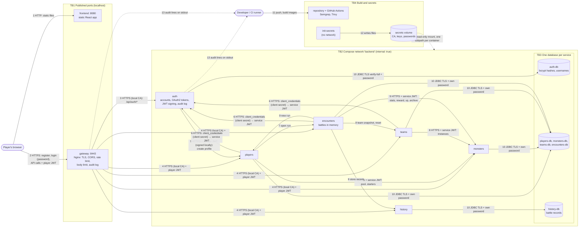

# Monster Tamers — Threat model

SEC-2 of [docs/plan/13-threat-model.md](docs/plan/13-threat-model.md), from the Security Assessment lab (18/11/2026). This document describes the system **as it is today** (`main`, 18/11/2026), not the system we plan to have. Controls that are only planned (INFRA-9, INFRA-10, AUTH-7, AUTH-8, HI-2, TEST-5, CI-3) show up as **Gap** or **Partial**, with the task that will close them.

It is a living document. When a P2 task changes a control, update its rows. When the architecture changes, start again from step 1.

| Step | Section |
|---|---|
| 1. Model | [Data flow diagram](#1-data-flow-diagram) |
| 2–4. Assets, attack surfaces, trust boundaries | [Assets](#2-assets), [Attack surfaces](#3-attack-surfaces), [Trust boundaries](#4-trust-boundaries) |
| 5. Threats | [STRIDE table](#5-threats-stride) |
| 6. Rate and decide | [Ratings and decisions](#6-ratings-and-decisions), [The fixed gap: audit log](#7-the-fixed-gap-audit-log) |

---

## 1. Data flow diagram

Every arrow is numbered and says how the data travels. `subgraph` blocks are trust boundaries.



| # | Flow | Protocol and credential |
|---|---|---|
| 1 | Browser → frontend: the built React app | **Plain HTTP** on `localhost:8080` (separate stack `docker-compose.frontend.yml`) |
| 2 | Browser → gateway: register (JSON), login (form, password), every API call | HTTPS, TLS 1.2/1.3, certificate from the local CA; player JWT in `Authorization: Bearer`; CORS only for listed origins |
| 3 | Gateway → auth | HTTPS re-encrypted, auth certificate verified against the local CA |
| 4 | Gateway → business services | Same as 3; the player JWT is forwarded and verified by each service |
| 5 | auth → players: `POST /internal/players` at registration | HTTPS + service JWT that auth signs itself |
| 6 | players, teams, encounters → auth: `POST /internal/auth/token` | HTTPS, `client_credentials` with a per-caller secret; returns a 300 s service JWT |
| 7 | players → monsters (pool, starters), players → encounters (open run) | HTTPS + service JWT |
| 8 | teams → monsters (owned instances) | HTTPS + service JWT |
| 9 | encounters → monsters, teams, players, history (battle end, reset) | HTTPS + service JWT; internal writes are idempotent |
| 10 | Each service → its own Postgres | JDBC with `sslmode=verify-full`, one password per database |
| 11 | Repository → CI → images | GitHub Actions: build, tests, Semgrep, Trivy; images built locally by `docker compose build` |
| 12 | init-secrets → secrets volume → containers | Files; each container mounts only its subpath, read-only; `ca.key` is never mounted |
| 13 | gateway, auth → logs | JSON audit lines on stdout, kept by Docker on the host |

### What a first draft got wrong

A draft generated from `docker-compose.yml` alone was checked against the compose files and the REST clients in `backend/*/src/main/java/**/client/`. Corrections:

- Compose has **no service-to-service calls**: every arrow from 5 to 9 comes from the `client/` interfaces. Arrow 5 (auth → players at registration) and the client-credentials arrows 6 are the easiest to miss.
- `history` and `monsters` make **no outgoing calls**. A plausible but wrong arrow `history → monsters` was removed.
- The frontend is **not behind the gateway**. It is a separate compose project, and the browser calls the gateway directly (CORS). Its port speaks plain HTTP (arrow 1).
- `init-secrets` has **no network** (`network_mode: none`). It touches the system only through the volume (arrow 12).
- `auth` does not ask itself for service tokens: it signs them locally (arrow 5).
- The test override (`docker-compose.test.yml`) publishes the six services on `127.0.0.1:9001–9006`. It is not part of the normal system and is listed as an attack surface only (AS4).

Arrow 12 points to the whole `backend` network to keep the drawing readable. In reality every container, the gateway included, mounts only its own subpath.

---

## 2. Assets

| ID | Asset | Where | Why it matters |
|---|---|---|---|
| A1 | Player password hashes (bcrypt) | auth-db | Offline guessing if leaked |
| A2 | Usernames | auth-db (plain until AUTH-8) | Personal data (US-05) |
| A3 | JWT signing private key | `auth` container only | Whoever has it can mint any player or service token |
| A4 | Service client secrets | `auth` and each caller | Give the `service` role on every internal API |
| A5 | DB passwords, TLS private keys, local CA key | Secrets volume | Access to data, impersonation of a service |
| A6 | Player access tokens | Browser `localStorage`, in transit | Act as the player until expiry (3600 s today) |
| A7 | Game state: collection, XP, teams, runs, profile | players/monsters/teams/encounters DBs, in-memory battles | Integrity of the game |
| A8 | Battle history | history-db | Must not be changed silently (US-25) |
| A9 | Availability of the API | gateway, auth (bcrypt), single `encounters` instance | Game unusable for everybody |
| A10 | Audit evidence | gateway and auth logs | Proof of who did what (SEC-3, SEC-4) |

## 3. Attack surfaces

| ID | Surface | Who can reach it |
|---|---|---|
| AS1 | Public API through the gateway: `register`/`token` (no token), player APIs (JWT), public sprites | Anyone who reaches `:8443` |
| AS2 | Frontend site on `:8080` and the browser storage | Anyone who reaches `:8080`; scripts running in the page |
| AS3 | Internal endpoints `/internal/*` of every service | Only containers on the `backend` network (gateway answers 404) |
| AS4 | Test override ports `127.0.0.1:9001–9006` and the `tests` client | Local processes, only while the test override runs |
| AS5 | Dependencies (Maven, npm) and base images | Upstream maintainers, registries |
| AS6 | Repository and CI pipeline | Repository collaborators, GitHub Actions |
| AS7 | Docker host: volumes, container logs | Local users with Docker access |

## 4. Trust boundaries

| ID | Boundary | What changes when data crosses it |
|---|---|---|
| TB1 | Browser / internet → published ports | Untrusted input. The gateway enforces TLS, body size, rate limit on auth, CORS; it writes the audit line |
| TB2 | Gateway → `backend` network | Requests come only through the gateway (the network is `internal: true`). Services still verify every JWT and role themselves; they do not trust the network alone |
| TB3 | Service → its database | Each database accepts only its own service's password over verified TLS; no service can read another service's data |
| TB4 | Build and secrets → running containers | Code and images come from the repository and registries; secrets are generated at first start, never committed, and mounted per container |

---

## 5. Threats (STRIDE)

Each element and arrow of the diagram was asked the STRIDE letters that apply (external entity: S, R; process: all six; data store: T, R, I, D; data flow: T, I, D).

**Status:**
- **Covered**: a control, plus a test that runs in CI.
- **Partial**: a control without a CI test (for example only in the manual `scripts/security-check.sh`), or a control with a written limit.
- **Gap**: no control.

Test paths: Bruno requests are under `docs/tests/bruno/`, Java tests under `backend/<svc>/src/test/java/…`.

| # | STRIDE | Where | Threat | Control (plan task) | Test | Status |
|---|---|---|---|---|---|---|
| 1 | S | Arrow 2, auth | An attacker guesses a player's password with many logins | bcrypt; same `invalid_grant` for wrong password and unknown user; Nginx `10r/m` burst 5 per IP → 429 (AUTH-3, INFRA-5) | `TokenResourceTest#wrongPasswordAndUnknownUserGiveTheSameError`; 429 only in `security-check.sh` §10 | Partial |
| 2 | S | Arrow 4, every service | A forged JWT (`alg:none`, wrong signature, expired) is sent to a service | Local RS256 verification of signature, issuer, audience, expiry (INFRA-7) | `auth/…/security/TokenVerificationTest`; `e2e/17-bad-token.bru` (monsters); `alg:none` only in `security-check.sh` §2 | Partial |
| 3 | S | Arrow 6 | Someone inside the `backend` network uses a stolen client secret to get service tokens | One secret per caller, mounted only in that container; failed attempts audited (SEC-3) | `InternalTokenResourceTest#wrongSecretIsInvalidClient`; `AuditTrailTest#aWrongClientSecretIsRecordedWithoutTheSecret` | Partial |
| 4 | E | Arrow 4, internal APIs | A player token is used on a service's internal endpoint | `@RolesAllowed("service")` on every internal resource | `services/players/internal/02-post-create-player-token-forbidden.bru`, `services/teams/internal/02-get-team-wrong-role.bru`, `services/history/internal/06-post-store-wrong-role.bru`, `services/encounters/internal/04-post-open-run-wrong-role.bru` | Covered |
| 5 | T | Arrow 2 → encounters | A player sends `outcome`/`hp` fields to forge a battle result | Outcome computed only by the engine; unknown JSON fields rejected | `services/encounters/public/16-post-action-invalid-outcome-field.bru` | Covered |
| 6 | T | Arrow 2 | Hostile input: huge body, unknown fields, out-of-range values | Bean Validation, `fail-on-unknown-properties`, 16 KB body limit → 413 | Invalid-input Bruno requests (e.g. `services/monsters/public/02-get-catalogue-invalid-filter.bru`, `services/history/internal/05-post-store-invalid-unknown-field.bru`); 413 only in `security-check.sh` §7 | Partial |
| 7 | T, I | Arrows 3–10 | Someone on the compose network reads or alters service-to-service traffic | TLS on every hop; certificates verified against the local CA (`proxy_ssl_verify on`, TLS configuration `internal`, JDBC `verify-full`) | CI step "Plain HTTP to the gateway is refused"; no-trust-all grep only in `security-check.sh` §9; no test with an untrusted certificate | Partial |
| 8 | T | Arrow 1 | Someone on the network path changes the frontend JavaScript, which is served over plain HTTP | None (localhost only by default) | None | Gap |
| 9 | T | history-db | Someone with database access edits or deletes battle records | None until HI-2 (append-only trigger, hash chain) | None | Gap |
| 10 | T | TB4, AS5 | A compromised dependency or base image reaches the running stack | Pinned versions and digests; Trivy `fs` and `image` in CI (CI-2); Dependabot planned (CI-4) | CI jobs `Dependencies (Trivy fs)` and image scan (known CVEs only, not malicious code) | Partial |
| 11 | R | auth (logins, registration, service tokens) | A player or a service denies having logged in; failed logins cannot be attributed to an account | JSON audit line per login, registration and service token, with player_id or blind index (SEC-3) | `auth/…/audit/AuditTrailTest`, `AuditLogTest`, `UsernameBlindIndexTest`; `scripts/check-audit-log.sh` (CI `compose-smoke`) | Gap → fixed |
| 12 | R | Gateway (every request) | A player denies an operation; nobody can tell which request did what | JSON audit line per request with method, path, status, outcome and `request_id` (SEC-4). `user` is `-` until INFRA-9 provides a verified subject | `scripts/check-audit-log.sh` (CI `compose-smoke`) | Gap → Partial |
| 13 | R, T | Container logs (AS7) | Someone with Docker access on the host edits or deletes audit lines | None (stdout, Docker `json-file` driver) | None | Gap |
| 14 | I | Arrow 2 → teams, monsters, history | A player reads another player's team, monster instance or battle by ID | Ownership check → 404 (P-11) | `services/teams/public/14-get-get-invalid-foreign.bru`, `services/monsters/public/17-get-instance-invalid-foreign.bru`, `services/history/internal/11-get-detail-invalid-foreign.bru` | Covered |
| 15 | I | auth-db | A database dump reveals usernames | AES-GCM + HMAC blind index planned (AUTH-8) | None | Gap |
| 16 | I | Logs | A password, a token or a username ends up in the logs | Logging convention; audit values chosen by the code; blind index instead of the username (P-27); Nginx logs `$uri` only | `AuditTrailTest` (password, token, username absent); `scripts/check-audit-log.sh` "Never recorded" | Covered |
| 17 | I | Arrow 2 | Error responses reveal internals (stack traces, SQL) | Common error format, exception mappers in every service | Only in `security-check.sh` (`no_leak`) | Partial |
| 18 | I, E | Browser (AS2) | A script injected in the page (XSS) steals the token from `localStorage` | React renders text, no raw HTML; CSP meta tag in the production build (FE-1, P-17) | None automated (SEC-1 XSS check open) | Partial |
| 19 | I | AS3 | Internal or management endpoints are reachable from outside | Gateway 404 for `/internal/*`, `/q/*` and unknown paths; `backend` network is `internal: true` | `e2e/15-internal-not-exposed.bru` | Covered |
| 20 | D | Arrow 2 → auth | A flood of logins or registrations exhausts the CPU (bcrypt) | Nginx `limit_req` on token and register → 429 | Only in `security-check.sh` §10 | Partial |
| 21 | D | encounters | Many open battles fill the memory of the single `encounters` instance | One battle per player (`409 BATTLE_IN_PROGRESS`); registrations rate-limited; idle battles closed lazily | `services/encounters/public/14-post-battle-invalid-twice.bru` | Partial |
| 22 | D | Gateway, all player APIs | A logged-in script floods the API (no rate limit outside auth) | 16 KB body limit, proxy timeouts | None | Gap |
| 23 | E | Arrow 2 → services | A request reaches a business service with no authorization at the gateway | Every service verifies JWT and role; gateway check planned (INFRA-9, INFRA-10) | `e2e/16-no-token.bru` (401 from the service) | Partial |
| 24 | E, S | A6 | A stolen access token is used after the theft | Lifetime 3600 s, no revocation; 300 s + refresh rotation + logout planned (AUTH-7) | `TokenResourceTest#correctCredentialsReturnAPlayerToken` (asserts 3600 s) | Partial |
| 25 | E | Arrow 2 → teams | A player builds a team with another player's monsters | Team validator checks ownership through monsters | `services/teams/public/13-post-create-invalid-foreign-monster.bru`, `services/teams/public/10-put-update-invalid-foreign.bru` | Covered |

25 threats, all six letters. Status: 6 Covered, 12 Partial, 5 Gap, 2 Gap closed (fully or partially) by this work.

---

## 6. Ratings and decisions

Each Gap and Partial row is rated for what is left **after** the existing control.

- **Likelihood:** high = anyone, with a script, today. Medium = a logged-in user, or an attacker with some skill and luck. Low = needs a foothold inside the network or the host.
- **Impact:** high = personal data leaked, or the service stops for everybody. Medium = one user's data, or a short stop. Low = a little information, nothing lost for good.

| # | Likelihood | Impact | Reason (one line) | Decision |
|---|---|---|---|---|
| 11, 12 | high | high | A whole STRIDE letter had no control: nobody could prove who did what, or even see the attacks of rows 1, 20 and 22 | **Mitigate now**: audit log (SEC-3, SEC-4), see §7 |
| 22 | high | medium | Any logged-in script can send unlimited requests; the service slows down, nothing is lost | **Mitigate next**: a generous per-IP `limit_req` on `/api/`, tuned with the audit lines |
| 1 | medium | medium | The per-IP limit slows down one machine; many IPs or a leaked password still work | **Mitigate**: per-account backoff (AUTH-8) |
| 20 | high | medium | The control exists but no CI test proves it | **Mitigate**: move the 429 check into CI-3 |
| 6 | high | low | Validation is tested; only the 413 check is outside CI | **Mitigate**: move the 413 check into CI-3 |
| 17 | medium | low | Mappers exist; only the manual script checks the bodies | **Mitigate**: move `no_leak` into TEST-5 |
| 24 | medium | medium | A stolen token works for one hour and cannot be revoked | **Mitigate**: AUTH-7 (300 s, refresh rotation, logout) |
| 12 (user) | high | medium | Gateway lines say what happened but not which player | **Mitigate**: INFRA-9 adapter returns the verified `sub` (P-28) |
| 2 | low | high | Services are reachable only inside the `backend` network; one forged-token test per service is missing | **Mitigate**: TEST-5 / CI-3 matrix on every service |
| 23 | low | high | Services verify alone; one missing annotation would expose an endpoint | **Mitigate**: INFRA-9 + INFRA-10 (defence in depth) |
| 15 | low | high | Needs a database dump, but it leaks every username | **Mitigate**: AUTH-8 |
| 18 | low | high | No known injection point; React escapes text; a token in `localStorage` is readable by any script | **Mitigate**: add the SEC-1 XSS check; keep CSP. Look again if raw HTML is ever rendered |
| 7 | low | high | TLS is verified, but no test proves that a wrong certificate is refused | **Mitigate**: add a negative test with a certificate from another CA (TEST-5) |
| 3 | low | high | Needs a foothold in a container; the secret then gives the `service` role until the volume is regenerated | **Accept**: rotation needs a new volume. Look again with mutual TLS or service-token audiences per caller |
| 10 | low | high | Pins and scans stop known CVEs, not a malicious release | **Accept** with CI-4 (reviewed update PRs). Look again before the final delivery |
| 8 | low | high | Malicious JS could steal tokens, but the frontend is served only on localhost | **Accept** for local use. Look again if the frontend is ever exposed: serve it over HTTPS |
| 9 | low | medium | Needs database access; US-25 requires the protection anyway | **Mitigate**: HI-2 |
| 21 | low | medium | At most one battle per registered player; registration is rate-limited | **Accept** (R19, single instance). Look again with EN-5 (sweep) |
| 13 | low | medium | Needs Docker access on the host | **Accept**: residual risk of the audit log, see §7 |

Grid (rows on the likelihood × impact grid):

| Impact ↓ / Likelihood → | low | medium | high |
|---|---|---|---|
| **high** | 2, 3, 7, 8, 10, 15, 18, 23 | — | **11, 12** |
| **medium** | 9, 13, 21 | 1, 24 | 12 (user), 20, 22 |
| **low** | — | 17 | 6 |

**Why the audit log first.** The grid puts 11/12 at the top. The fix is cheap and does not change the behaviour of the API. Without it, the guessing of row 1 and the floods of rows 20 and 22 cannot be seen, and a rate limit cannot be tuned. Row 22 comes next.

---

## 7. The fixed gap: audit log

**Control.** One JSON line per event, written only at the two entry points (decision P-26):

- **auth** ([`AuditLog`](backend/auth/src/main/java/it/unipi/ase/tamer/auth/audit/AuditLog.java)): events `login`, `register`, `service_token`.
  - `user` is the `player_id` on success, the username's HMAC blind index on a denial, or `?` for a username that cannot exist (P-27). The client id is used for services.
  - Lines are serialized with Jackson: newlines, control characters and non-ASCII are escaped, and every value is cut to 64 characters.
- **gateway** (`log_format audit escape=json` in [`default.conf.template`](gateway/templates/default.conf.template)): one `request` line per request, with outcome (`success` < 400, `denied` 401/403, `failure` otherwise), method, path without query string, status and `request_id`.
  - Health checks are not recorded.
  - `user` is `-` until INFRA-9 provides a verified subject (P-28).
- The gateway `request_id` reaches auth as `X-Request-Id`, so a login's gateway line and auth line can be matched.

```json
{"ts":"2026-11-18T10:02:11+00:00","event":"request","user":"-","outcome":"failure","method":"POST","path":"/api/auth/token","status":"400","request_id":"3f…","ip":"172.18.0.1","rt":"0.093"}
{"ts":"2026-11-18T10:02:11Z","event":"login","user":"9c1e…(64 hex)","outcome":"denied","request_id":"3f…","reason":"invalid_grant"}
```

Never recorded: passwords, tokens, client secrets, request bodies, headers, plain usernames.

**Tests.**

| Test | Proves |
|---|---|
| `AuditLogTest` (8) | Fields and UTC time; one line per call; a newline in a value cannot forge a second line; control and non-ASCII characters escaped; 64-character cut; facts cannot overwrite `user`/`outcome` |
| `UsernameBlindIndexTest` (6) | 64 hex characters; stable across case; depends on the key; malformed usernames → `?` |
| `AuditTrailTest` (9, `@QuarkusTest`) | Wrong password, unknown user, malformed username, correct login, wrong and correct client secret, registration success/duplicate/failure each produce exactly one line with the right user and outcome; password, token, secret and plain username never appear |
| `scripts/check-audit-log.sh` (CI `compose-smoke`) | On the running stack: one gateway line per request with the right outcome; auth lines with the same `request_id`; health checks not logged; password, token, username and `Bearer` absent from the whole gateway and auth logs |

**Does it fail when it should?** Checked on 18/11/2026:

- With the `AuditLog.audit(LOGIN, DENIED, …)` call commented out in `TokenService`, 4 of the 9 `AuditTrailTest` tests turn red.
- With the `access_log … audit` line removed from the gateway template, `check-audit-log.sh` fails.

**Residual risk** (accepted, row 13):
- The lines go to the containers' stdout. Anyone with Docker access on the host can read, edit or delete them, and they disappear with the containers.
- Sending them to a collector that the application cannot change is out of scope for a single development host. Look again if the system is deployed elsewhere.
- No alert is raised (for example on many `denied` lines in a minute). The lines are structured so that one can be added.
- Until INFRA-9, the gateway lines do not name the player; only auth's login lines do.

**Secret.** The blind index key `tamer.crypto.username-hmac-key` is generated by `init-secrets`. On an existing secrets volume it is appended at the next start, so the volume does not need to be deleted.

---

## Review

- [x] Diagram checked against `docker-compose.yml`, `docker-compose.frontend.yml`, `docker-compose.test.yml`, the gateway template and every REST client.
- [ ] Read aloud to a team member who did not write it (lab step 1.4): note here any arrow they did not understand.
- [ ] Update the rows when INFRA-9, INFRA-10, AUTH-7, AUTH-8, HI-2, TEST-5 or CI-3 land.
