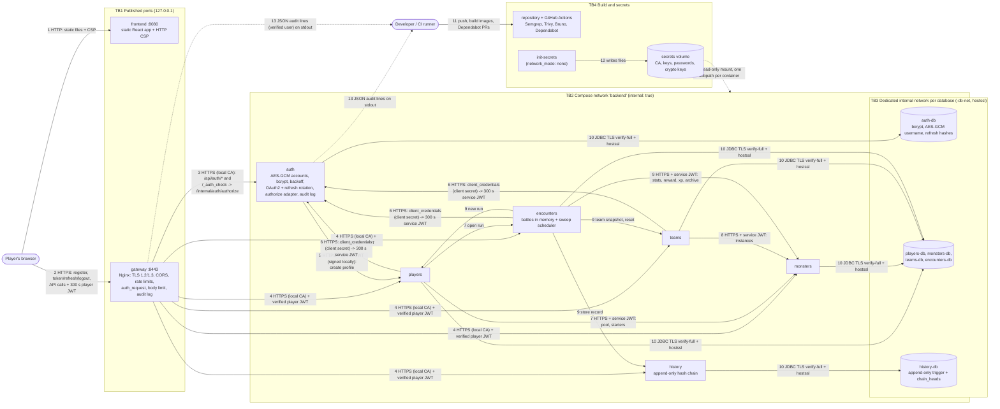

# Monster Tamers — Threat model

SEC-2 of [docs/plan/13-threat-model.md](docs/plan/13-threat-model.md), from the Security Assessment lab (18/11/2026), updated for the completed Phase 2 final system (`main`, 27/11/2026). All planned P2 controls (`INFRA-3` `pg_hba.conf`, `INFRA-9`, `INFRA-10`, `AUTH-7`, `AUTH-8`, `HI-2`, `TEST-5`, `CI-3`, `CI-4`, `SEC-1`, `SEC-3`, `SEC-4`, Threat #22 rate limit, per-service DB network isolation, `read_only` containers) are implemented and verified.

| Step | Section |
|---|---|
| 1. Model | [Data flow diagram](#1-data-flow-diagram) |
| 2–4. Assets, attack surfaces, trust boundaries | [Assets](#2-assets), [Attack surfaces](#3-attack-surfaces), [Trust boundaries](#4-trust-boundaries) |
| 5. Threats | [STRIDE table](#5-threats-stride) |
| 6. Rate and decide | [Ratings and decisions](#6-ratings-and-decisions), [Audit log & access controls](#7-implemented-controls-audit-log-and-p2-mitigations) |

---

## 1. Data flow diagram

Every arrow is numbered and says how the data travels. `subgraph` blocks are trust boundaries.

| # | Flow | Protocol and credential |
|---|---|---|
| 1 | Browser → frontend: built React app | **Plain HTTP** on `127.0.0.1:8080` (separate stack `docker-compose.frontend.yml`, HTTP `Content-Security-Policy` + `Permissions-Policy`) |
| 2 | Browser → gateway: register (JSON), token/refresh/logout (form), API calls | HTTPS, TLS 1.2/1.3, local CA cert; 300 s player JWT in `Authorization: Bearer`; CORS only for listed origins; per-IP rate limits on auth (`10r/m`) and `/api/*` (`120r/m`) |
| 3 | Gateway → auth | HTTPS re-encrypted, auth cert verified against local CA; covers `/api/auth/{register,token,logout}` and internal `auth_request` subrequests (`GET /internal/auth/authorize`) returning verified `X-Auth-Subject` |
| 4 | Gateway → business services | Same as 3; authorized at gateway via `access-policy.json`, bearer JWT forwarded untouched (`X-Auth-Subject` stripped) and verified independently in every service |
| 5 | auth → players: `POST /internal/players` at registration | HTTPS + locally signed 300 s service JWT |
| 6 | players, teams, encounters → auth: `POST /internal/auth/token` | HTTPS, `client_credentials` with a per-caller secret; returns a 300 s service JWT (no refresh token) |
| 7 | players → monsters (pool, starters), players → encounters (open run) | HTTPS + service JWT |
| 8 | teams → monsters (batched owned instances) | HTTPS + service JWT |
| 9 | encounters → monsters, teams, players, history (battle end, reset) | HTTPS + service JWT; internal writes are idempotent and retried by outbox/scheduler |
| 10 | Each service → its own Postgres | JDBC `sslmode=verify-full` over dedicated `<svc>-db-net` internal network; Postgres `pg_hba.conf` enforces `hostssl` and rejects plaintext TCP |
| 11 | Repository → CI → images | GitHub Actions: policy sync, JUnit, Vitest, Bruno (component/integration/e2e/access), `check-audit-log.sh`, `security-check.sh`, Semgrep, Trivy (fs/image/config), weekly Dependabot |
| 12 | init-secrets → secrets volume → containers | Files; each container mounts only its own subpath read-only; `ca.key` is never mounted; only caller services receive client secrets |
| 13 | gateway, auth → logs | JSON audit lines on stdout; gateway records verified `player_id` from `INFRA-9` adapter (never from client headers) |

### What a first draft got wrong (preserved from lab step 1.2)

A draft generated from `docker-compose.yml` alone was checked against the compose files and the REST clients in `backend/*/src/main/java/**/client/`:

- Compose has **no service-to-service calls**: arrows 5–9 come from the `client/` interfaces.
- `history` and `monsters` make **no outgoing calls**.
- The frontend is **not behind the gateway**: separate compose stack, direct CORS calls to `:8443`.
- `init-secrets` has `network_mode: none` and touches the system only through the secrets volume.
- `auth` signs its own service tokens locally for `auth → players` (arrow 5) and now also serves the private `auth_request` authorization adapter for the gateway (arrow 3).
- In P2, each database was moved off the shared `backend` network onto its own private `<svc>-db-net`, so the gateway and unrelated services have no network path to foreign databases.

---

## 2. Assets

| ID | Asset | Where | Why it matters |
|---|---|---|---|
| A1 | Player password hashes (bcrypt) | `auth-db` | Offline guessing if leaked |
| A2 | Usernames (AES-256-GCM + HMAC blind index) | `auth-db` | Personal data protected at rest (US-05, AUTH-8) |
| A3 | JWT signing private key & crypto keys | `auth` container only | Minting any player/service token or decrypting usernames |
| A4 | Service client secrets | `auth` and caller services (`players`, `teams`, `encounters`) | Grant `service` role on internal APIs |
| A5 | DB passwords, TLS private keys, local CA key | Secrets volume | Access to data, service impersonation |
| A6 | Player access tokens (300 s) & rotating refresh tokens | Browser `localStorage` (memory fallback), `auth-db` (SHA-256 hashes only) | Act as player until expiry or family revocation |
| A7 | Game state: collection, nicknames, XP, teams, runs, profile | `players`/`monsters`/`teams`/`encounters` DBs, in-memory battles | Integrity of the game |
| A8 | Battle history & hash chain (`chain_heads`) | `history-db` (append-only trigger) | Must not be altered or deleted silently (US-25, HI-2) |
| A9 | Availability of the API | gateway, auth (bcrypt), single `encounters` instance | Game unusable for everybody |
| A10 | Audit evidence | gateway and auth logs | Proof of who did what (SEC-3, SEC-4) |

## 3. Attack surfaces

| ID | Surface | Who can reach it |
|---|---|---|
| AS1 | Public API through the gateway (`127.0.0.1:8443`): `register`/`token`/`logout`, authorized player APIs, public sprites | Localhost callers reaching `:8443` |
| AS2 | Frontend site (`127.0.0.1:8080`) and browser storage | Localhost browser sessions |
| AS3 | Internal endpoints `/internal/*` of every service | Only containers on `backend` network (gateway answers 404; `/internal/auth/authorize` only via internal subrequest) |
| AS4 | Test override ports `127.0.0.1:9001–9006` and the `tests` client | Local processes only while `docker-compose.test.yml` runs |
| AS5 | Dependencies (Maven, npm, pip) and base images | Upstream maintainers, registries |
| AS6 | Repository and CI pipeline | Repository collaborators, GitHub Actions |
| AS7 | Docker host: volumes, container logs | Local users with Docker access |

## 4. Trust boundaries

| ID | Boundary | What changes when data crosses it |
|---|---|---|
| TB1 | Browser / localhost → published ports | Untrusted input. Gateway enforces TLS 1.2/1.3, 16 KB body limit, auth & API rate limits, CORS, `auth_request` authorization, and JSON request audit logging with verified `sub` |
| TB2 | Gateway → `backend` network | Requests enter only via gateway (`internal: true`). Every service still independently verifies JWT signature/claims and enforces `access-policy.json` via `AccessPolicyFilter` |
| TB3 | Service → its own database (`<svc>-db-net`) | Dedicated internal network per DB; Postgres enforces `hostssl` (`pg_hba.conf`) and rejects plaintext TCP; each service authenticates with its own generated password |
| TB4 | Build and secrets → running containers | Pinned versions/digests, Semgrep + Trivy + Dependabot; secrets generated at first start by networkless `init-secrets`, mounted read-only per subpath; containers run non-root with `read_only: true`, `cap_drop: ALL`, `no-new-privileges`, memory and PID limits |

---

## 5. Threats (STRIDE)

**Status:**
- **Covered**: control implemented and verified by automated tests executed in CI.
- **Partial**: control implemented with a documented residual boundary or manual-only negative test.
- **Gap**: no control (accepted with written rationale).

| # | STRIDE | Where | Threat | Control (plan task) | Test | Status |
|---|---|---|---|---|---|---|
| 1 | S | Arrow 2, auth | Password guessing via repeated logins | bcrypt; uniform `invalid_grant`; Nginx `10r/m` burst 5 per IP → 429; per-account login backoff 5 failures/15 min (AUTH-3, AUTH-8, INFRA-5) | `TokenResourceTest`, `LoginBackoffTest`, `security-check.sh` §10 | Covered |
| 2 | S | Arrow 4, every service | Forged JWT (`alg:none`, wrong signature, altered payload, expired) sent to gateway or directly to a service | Gateway `auth_request` (`INFRA-9`) + local RS256 verification in every service (`INFRA-7`) | `TokenVerificationTest`, `AuthorizeResourceTest`, `access/04..08-*.bru` (component & integration), `security-check.sh` §2 | Covered |
| 3 | S | Arrow 6 | Compromised container uses a stolen client secret to mint service tokens | One secret per caller only (non-callers receive none), mounted read-only per subpath; failed attempts audited (INFRA-4, SEC-3) | `InternalTokenResourceTest`, `AuditTrailTest` | Partial (accepted) |
| 4 | E | Arrow 4, internal APIs | Player token used on `/internal/*` or service token used on `/api/*` | Single `access-policy.json` enforced by `AccessPolicyFilter` + `@RolesAllowed` + gateway `auth_request` (`INFRA-9`, `INFRA-10`) | `PlayersResourceTest`, `MonstersResourceTest`, `TeamsResourceTest`, `HistoryResourceTest`, `AuthorizeResourceTest`, Bruno `internal/` + `scripts/check-policy-sync.sh` | Covered |
| 5 | T | Arrow 2 → encounters | Player sends `outcome`/`hp` fields to forge a battle result | Server-side battle engine v2; unknown JSON fields rejected | `services/encounters/public/16-post-action-invalid-outcome-field.bru`, `security-check.sh` §5 | Covered |
| 6 | T | Arrow 2 | Hostile input: huge body, unknown fields, SQLi, out-of-range values | Bean Validation, `fail-on-unknown-properties`, 16 KB gateway limit → 413, parameterized queries | Bruno invalid-input requests, `TeamsResourceTest` (>50 IDs → 400), `security-check.sh` §1 & §7 (in CI `compose-smoke`) | Covered |
| 7 | T, I | Arrows 3–10 | Network-level eavesdropping or tampering on service/DB traffic | TLS 1.2/1.3 everywhere (`proxy_ssl_verify on`, JDBC `verify-full`), Postgres `pg_hba.conf` `hostssl` rejects plaintext, dedicated `<svc>-db-net` networks (`INFRA-3`, `INFRA-4`, `INFRA-5`) | CI plain-HTTP refusal check, `security-check.sh` §9 (no `trust-all`, TLS 1.1 refused) | Partial |
| 8 | T | Arrow 1 | Tampering with frontend JS served over plain HTTP | Bound to `127.0.0.1:8080` only (local use) | Accepted for local deployment | Gap (accepted) |
| 9 | T | `history-db` | Silent edit or deletion of battle records | Postgres `BEFORE UPDATE OR DELETE` append-only trigger (`V2__append_only.sql`) + per-player SHA-256 hash chain + `GET /api/history/verify` (`HI-2`, US-25) | `HistoryResourceTest` (trigger rejection + tampering detection), `HashChainTest`, `services/history/public/09-get-verify-valid.bru` | Covered |
| 10 | T | TB4, AS5 | Compromised dependency or base image reaches running stack | Exact version/digest pins, Semgrep SAST, Trivy `fs`/`image`/`config` in CI, weekly Dependabot (`CI-2`, `CI-4`), scheduled weekly CI run | CI jobs `sast`, `deps`, `images`, `config`; `.github/dependabot.yml` | Covered |
| 11 | R | `auth` | Repudiation of login, registration, refresh, logout, or service token use | JSON audit log on `audit` category (`login`, `register`, `refresh`, `refresh_reuse`, `logout`, `service_token`) with `player_id` or HMAC blind index (`SEC-3`) | `AuditLogTest`, `UsernameBlindIndexTest`, `AuditTrailTest`, `scripts/check-audit-log.sh` (CI `compose-smoke`) | Covered |
| 12 | R | Gateway | Repudiation of API operations at the gateway | JSON `log_format audit` per request with verified `user` (`X-Auth-Subject` from `INFRA-9` adapter), `outcome`, `path`, `status`, `request_id` (`SEC-4`, `INFRA-9`) | `scripts/check-audit-log.sh` (asserts `.user == $PLAYER_ID`, in CI `compose-smoke`) | Covered |
| 13 | R, T | Container logs (AS7) | Docker host user edits or deletes stdout audit logs | Stdout (`json-file` driver); append-only remote log collector out of scope for single dev host | Accepted residual risk (see §7) | Gap (accepted) |
| 14 | I | Arrow 2 → teams, monsters, history, runs | IDOR: reading or modifying another player's resource by ID | Ownership scoping → `404` (`P-11`) | Bruno IDOR tests, `MonstersResourceTest`, `TeamsResourceTest`, `HistoryResourceTest`, `security-check.sh` §3 (in CI) | Covered |
| 15 | I | `auth-db` | Database dump reveals player usernames | `username` encrypted with AES-256-GCM (random 12-byte IV) + HMAC-SHA256 blind index (`AUTH-8`, `V2__encrypt_username.sql`) | `UsernameCryptoTest`, `RegistrationResourceTest` (verifies DB columns) | Covered |
| 16 | I | Logs | Password, access/refresh token, client secret, or plain username leaks into logs | Structured audit values only, HMAC blind index, Nginx logs `$uri` without query string or headers | `AuditTrailTest`, `scripts/check-audit-log.sh` ("Never recorded": password, tokens, refresh tokens, username, `Bearer`) | Covered |
| 17 | I | Arrow 2 | Error responses leak stack traces or SQL | Common `ErrorResponse` + `ExceptionMappers` in every service | `CommonsTest`, `security-check.sh` (`no_leak`, in CI `compose-smoke`) | Covered |
| 18 | I, E | Browser (AS2) | XSS steals access/refresh tokens from `localStorage` | React escaping (no `dangerouslySetInnerHTML`/`eval`), HTTP `Content-Security-Policy` + `Permissions-Policy` in `frontend/nginx.conf`, `<meta>` CSP in Vite build | `security-check.sh` §8 + CI HTTP CSP header assertion | Covered |
| 19 | I | AS3 | Internal or Quarkus `/q/*` endpoints exposed externally | Gateway 404 for `/internal/*`, `/q/*`, unknown paths; `internal: true` networks; `/_auth_check` marked `internal` | `e2e/15-internal-not-exposed.bru`, `security-check.sh` §4 | Covered |
| 20 | D | Arrow 2 → auth | Login/registration/logout flood exhausts bcrypt CPU | Nginx `limit_req zone=auth` (`10r/m` burst 5) → 429 + per-account backoff | `LoginBackoffTest`, `security-check.sh` §10 | Covered |
| 21 | D | `encounters` | Open battles exhaust memory of single `encounters` instance | One active battle per player (`409`), fixed 256-stripe lock table (no leak), 1-minute `EncounterSweepScheduler` expires idle battles >30 min (`EN-5`), `mem_limit: 512m` | `EncounterSweepSchedulerTest`, `BattleApiTest`, `services/encounters/public/14-post-battle-invalid-twice.bru` | Covered |
| 22 | D | Gateway, `/api/*` | Logged-in script floods business APIs | Per-IP `limit_req zone=api` (`120r/m` burst 60) → 429 + 16 KB body limit + proxy timeouts | `default.conf.template`, Locust P2 benchmark (`0` failures at 56 req/s on test override) | Covered |
| 23 | E | Arrow 2 → services | Request reaches business service without gateway authorization | Gateway `auth_request` fails closed (`503` on auth outage, `401`/`403` on bad token/role) + independent service `AccessPolicyFilter` (`INFRA-9`, `INFRA-10`) | `AuthorizeResourceTest`, `access/04..09-*.bru` (component & integration), `AccessPolicyTest` in all 6 services | Covered |
| 24 | E, S | A6 | Stolen access or refresh token abused after theft | Access TTL reduced to **300 s**; rotating refresh tokens with reuse detection (revokes entire family) and server-side `POST /api/auth/logout` (`AUTH-7`, `FE-3`) | `RefreshAndLogoutTest`, `access/10..17-*.bru`, `frontend/src/session/session-refresh.test.ts` | Covered |
| 25 | E | Arrow 2 → teams | Player builds team using foreign monsters | `TeamValidator` + `MonstersClient` ownership check | `TeamsResourceTest`, `services/teams/public/13-post-create-invalid-foreign-monster.bru`, `security-check.sh` §3 | Covered |

**Summary (27/11/2026):** 25 threats across all six STRIDE letters — **21 Covered**, **2 Partial** (#3 accepted, #7 untrusted-CA negative test), **2 Gap (accepted)** (#8 localhost frontend HTTP, #13 host Docker log tampering). Zero unmitigated high-risk gaps remain.

---

## 6. Ratings and decisions (residual risk after P2)

| # | Residual Likelihood | Residual Impact | Reason (one line) | Decision |
|---|---|---|---|---|
| 3 | low | high | Requires container compromise inside `backend`; non-caller services no longer mount client secrets | **Accept**: rotate via volume regeneration; consider mTLS per caller in production |
| 7 | low | high | TLS 1.2+ verified on every hop + `hostssl` enforced by Postgres; no automated rogue-CA integration test | **Accept**: verified by config grep and TLS 1.1 refusal in CI |
| 8 | low | high | Frontend is bound to `127.0.0.1:8080` only | **Accept** for local use; serve over HTTPS if exposed externally |
| 13 | low | medium | Requires local Docker host privileges | **Accept**: remote append-only log sink out of scope for single-host project |
| 21 | low | medium | Bounded by 1 battle/player, 256-stripe lock table, 1-minute expiry sweep, and container memory cap | **Accept** (R19 single-instance design) |

---

## 7. Implemented controls: audit log and P2 mitigations

- **Entry-point JSON audit log (`SEC-3`, `SEC-4`, `INFRA-9`):**
  - `auth` ([`AuditLog`](backend/auth/src/main/java/it/unipi/ase/tamer/auth/audit/AuditLog.java)) logs `login`, `register`, `refresh`, `refresh_reuse`, `logout`, `service_token` with `player_id` on success, HMAC blind index on denial, and `request_id` correlation.
  - `gateway` ([`default.conf.template`](gateway/templates/default.conf.template)) logs every non-health request with `user` populated exclusively from `X-Auth-Subject` returned by `GET /internal/auth/authorize` (or `"-"` on public/denied routes; never read from client headers and never forwarded to business services).
  - Verified on 27/11/2026 via `scripts/check-audit-log.sh`: **18/18 passed** (including gateway `.user == $PLAYER_ID`, refresh, logout, and zero leakage of passwords, access tokens, refresh tokens, usernames, or `Bearer` headers).
- **Secrets generated by `init-secrets`:** generates `tamer.crypto.username-hmac-key` and `tamer.crypto.username-enc-key` (appended safely on existing volumes) and restricts `tamer.service-client.*` to caller services only.
- **Residual risk:** Audit lines remain on Docker stdout (`json-file`) without remote WORM shipping or automated alerting; accepted for local deployment.

---

## Review

- [x] Diagram updated and verified against `docker-compose.yml`, `docker-compose.frontend.yml`, `docker-compose.test.yml`, `gateway/templates/default.conf.template`, and all REST clients.
- [x] All P2 security controls (`INFRA-3` `hostssl`, `INFRA-9`, `INFRA-10`, `AUTH-7`, `AUTH-8`, `HI-2`, `TEST-5`, `CI-3`, `CI-4`, `SEC-1`, `SEC-3`, `SEC-4`, Threat #22) implemented, tested, and reflected in the STRIDE table.
- [ ] Oral team walkthrough of the updated DFD before the Jan/Feb discussion (recommended team prep).
