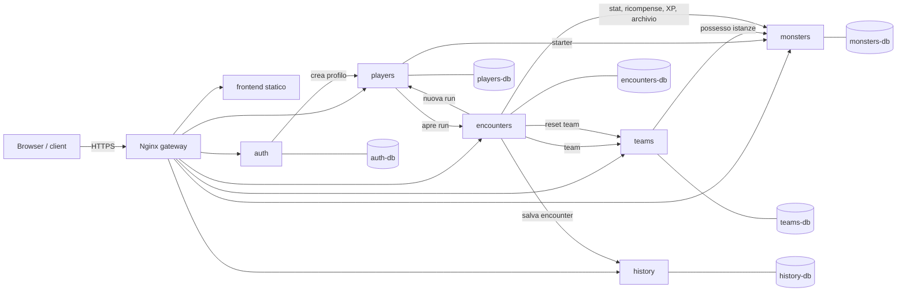
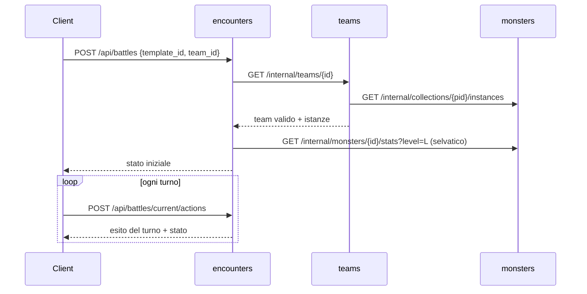
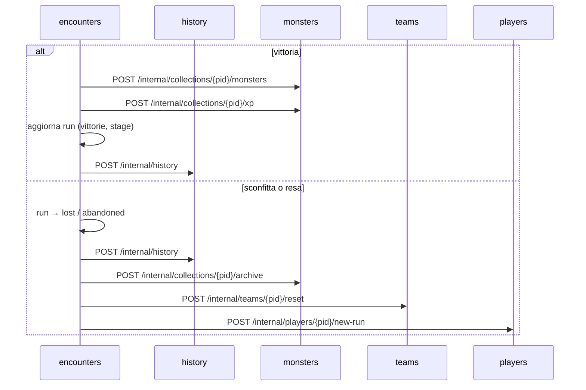

# Monster Tamers — Architettura del backend

Decisioni prese dal gruppo il 15/10/2026. Integra [`docs/design/area_giocatori_mostri.md`](../design/area_giocatori_mostri.md) (dati di giocatori e mostri) e i dati di seed in `backend/monsters/seed/`.

I valori numerici delle formule di gioco (sezione 4) sono **valori iniziali**: vanno bilanciati con simulazioni prima del prototipo.

> **Aggiornamento 09/11/2026:** il piano di implementazione in [`docs/plan/`](../plan/README.md) (06/11/2026) ha cambiato alcune decisioni di questo documento. Dove i due documenti non coincidono vale il piano. Le modifiche sono riassunte nella [sezione 10](#10-aggiornamento-del-091126-piano-di-implementazione). Le API effettive sono in [`docs/openapi/`](../openapi/). Il PDF (`architettura_backend.pdf`, da `.tex`) è fermo al 15/10.

---

## 1. Decisioni

### Architettura e tecnologie

| # | Tema | Decisione | Conseguenze |
|---|---|---|---|
| A1 | Framework | **Quarkus** (Java 21, ultima LTS 3.x) | Dev Services avvia Postgres nei test; estensioni pronte per REST, JWT, ORM, fault tolerance |
| A2 | Servizi | **6 servizi**: `auth`, `players`, `monsters`, `teams`, `encounters`, `history` | Confini chiari, 1–2 servizi per persona; più chiamate REST interne |
| A3 | Ingresso | **Nginx** come API gateway | Routing, HTTPS, rate limiting, frontend statico; nessun codice Java nel gateway |
| A4 | Database | **PostgreSQL, un container per servizio** | Database-per-service: nessun servizio legge i dati di un altro; ~6 container DB in compose |
| A5 | Comunicazione | **Solo REST sincrono** (Quarkus REST Client) | Un solo paradigma; resilienza con SmallRye Fault Tolerance (`@Retry`, `@Timeout`) e chiamate idempotenti |
| A6 | Autenticazione | **JWT RS256** firmato da `auth`, verificato in locale da ogni servizio | Stateless; access token breve (15 min) + refresh token revocabile |
| A7 | Chiamate interne | Endpoint sotto **`/internal/*`**, non instradati da Nginx, con **JWT di servizio** (ruolo `service`) | Il client non può raggiungerli (US-12); difesa su rete + identità |
| A8 | Persistenza | **Hibernate ORM con Panache + Flyway** | Migrazioni SQL versionate; il seed del catalogo è una migrazione |
| A9 | Build | **Maven**, pom aggregatore in `backend/`, **nessun modulo condiviso** | Un comando builda tutto; ogni servizio ha i propri DTO (qualche duplicazione accettata) |

### Regole di gioco

| # | Tema | Decisione |
|---|---|---|
| R1 | Struttura | **Roguelike a run**: una run va dalla scelta degli starter alla vittoria finale, alla sconfitta o alla resa |
| R2 | Obiettivo | **8 stage** di difficoltà crescente; battere il boss dello stage 8 vince la run |
| R3 | Encounter | **Battaglia interattiva a turni**, team contro un mostro selvatico |
| R4 | Formato | **1v1 a staffetta**: combatte un mostro del team alla volta, nell'ordine del team; il selvatico tiene i danni |
| R5 | Azioni | **Attacco**, **Cambio mostro**, **Fuga** (niente azione di cattura) |
| R6 | Ricompensa | **Vittoria = il selvatico entra in collezione**, sempre |
| R7 | Fuga | Riesce **con probabilità** che dipende dalla speed; se fallisce il turno è perso |
| R8 | Team | Da **1 a 3** mostri posseduti nella run corrente; **ammesse più copie della stessa specie** (non la stessa istanza due volte); nessun altro vincolo |
| R9 | Team nella run | **Modificabile tra un encounter e l'altro** |
| R10 | HP | **Pieni all'inizio di ogni encounter** (non persistono tra encounter) |
| R11 | XP | In vittoria **tutto il team** riceve XP, anche chi non è sceso in campo |
| R12 | Catalogo encounter | **Template statici** per stage; il selvatico è estratto a caso dal catalogo all'avvio |
| R13 | Boss | Uno per stage, **battibile una volta per run**; la vittoria dà il boss e sblocca lo stage successivo |
| R14 | Sconfitta | **Run persa, reset completo**: collezione, livelli e stage ripartono da zero; nuovi starter da un nuovo pool. Restano account, storico e run passate |
| R15 | Mostri delle run chiuse | **Archiviati**, non cancellati: il giocatore consulta le vecchie run per capire dove ha sbagliato |
| R16 | Fine run vinta | Run marcata `won`; il giocatore ne inizia una nuova quando vuole (con reset) |
| R17 | Resa | Il giocatore può **abbandonare la run**: stesso reset della sconfitta |
| R18 | Encounter attivi | **Uno alla volta** per giocatore; scade dopo **30 minuti** di inattività |
| R19 | Stato della battaglia | **In memoria** nel servizio `encounters`; la run è invece **persistita** in Postgres |
| R20 | Storico | **Riepilogo + log completo dei turni** per ogni encounter |

**Limite noto di R19.** Se `encounters` si riavvia, le battaglie in corso vanno perse (vengono chiuse come `interrupted`, senza ricompensa e senza perdere la run) e il servizio non si può replicare su più istanze. La run, lo stage e la collezione non si perdono.

---

## 2. Componenti



Le frecce tra servizi sono chiamate a endpoint `/internal/*` con JWT di servizio.

| Servizio | Responsabilità | Dati | User stories |
|---|---|---|---|
| `auth` | Registrazione, login, token, token di servizio | `Accounts`, `RefreshTokens` | US-01, US-02, US-05 |
| `players` | Profilo, pool degli starter, run corrente | `Players` | US-03, US-04, US-06, US-07 |
| `monsters` | Catalogo, abilità, elementi, collezione per run, livelli e XP, immagini | `Monsters`, `Abilities`, `Elements`, `OwnedMonsters` | US-09, US-10, US-11, US-12, US-13 |
| `teams` | Creazione, modifica e validazione dei team | `Teams`, `TeamSlots` | US-14, US-15, US-16 |
| `encounters` | Catalogo encounter, run, battaglie, orchestrazione di fine run | `EncounterTemplates`, `Runs` (+ battaglie in memoria) | US-17, US-18, US-19, US-20, US-21, US-22 |
| `history` | Storico persistente e integrità | `EncounterRecords` | US-23, US-24, US-25 |

### Gateway (Nginx)

| Percorso pubblico | Servizio |
|---|---|
| `/api/auth/*` | `auth` |
| `/api/players/*` | `players` |
| `/api/monsters/*`, `/api/abilities/*`, `/api/elements`, `/api/collection/*`, `/images/*` | `monsters` |
| `/api/teams/*` | `teams` |
| `/api/encounters/*`, `/api/runs/*`, `/api/battles/*` | `encounters` |
| `/api/history/*` | `history` |
| `/` | frontend statico |

`/internal/*` non è mai instradato. Nginx termina HTTPS e applica rate limiting su `/api/auth/login` e `/api/auth/register`.

---

## 3. API e database per servizio

Tutti gli endpoint pubblici, tranne registrazione e login, richiedono `Authorization: Bearer <access token>`. Il `player_id` si legge sempre dal claim `sub` del token, mai da parametri del client: un giocatore non può agire sui dati di un altro (US-05).

Gli endpoint interni che modificano dati sono **idempotenti** (chiave indicata in tabella): se una chiamata viene ripetuta da un `@Retry`, il risultato non cambia.

### 3.1 `auth`

| Metodo | Endpoint | Descrizione |
|---|---|---|
| POST | `/api/auth/register` | `{username, password}` → 201 `{player_id}`. Crea il profilo su `players`; se la chiamata fallisce l'account viene annullato |
| POST | `/api/auth/login` | → `{access_token, refresh_token, expires_in}`; errore generico se le credenziali sono sbagliate |
| POST | `/api/auth/refresh` | Nuovo access token da un refresh token valido |
| POST | `/api/auth/logout` | Revoca il refresh token |
| POST | `/internal/auth/service-token` | `{client_id, client_secret}` → JWT con ruolo `service` |

| Tabella | Campi principali |
|---|---|
| `accounts` | `player_id` PK, `username` unique, `password_hash` (bcrypt), `created_at`, `last_login` |
| `refresh_tokens` | `token_hash` PK, `player_id`, `expires_at`, `revoked` |

La chiave privata di firma esiste solo in `auth`; gli altri servizi montano la chiave pubblica.

### 3.2 `players`

| Metodo | Endpoint | Descrizione |
|---|---|---|
| GET | `/api/players/me` | Profilo, `current_run_id`, stato degli starter |
| PATCH | `/api/players/me` | Modifica `display_name` / avatar (US-04) |
| GET | `/api/players/me/starters` | Pool di 10 common della run corrente |
| POST | `/api/players/me/starters` | `{monster_ids: [a, b, c]}` → aggiunge gli starter in `monsters` e apre la run in `encounters` |
| POST | `/internal/players` | Crea il profilo (da `auth`) — idempotente su `player_id` |
| POST | `/internal/players/{pid}/new-run` | `{ended_run_id}` → nuovo `current_run_id`, nuovo pool, `starters_chosen = false` — idempotente: non fa nulla se `ended_run_id` non è la run corrente |

| Tabella | Campi principali |
|---|---|
| `players` | `player_id` PK, `display_name`, `avatar`, `current_run_id`, `starter_pool` (10 `monster_id`), `starters_chosen`, `created_at` |

Rispetto alla proposta precedente, `stage` passa nella run (`encounters`), perché si azzera a ogni run.

### 3.3 `monsters`

| Metodo | Endpoint | Descrizione |
|---|---|---|
| GET | `/api/monsters?element=&rarity=&page=&size=` | Catalogo paginato e filtrabile (US-10) |
| GET | `/api/monsters/{id}` | Dettaglio specie con abilità (US-11) |
| GET | `/api/abilities`, `/api/abilities/{id}`, `/api/elements` | Abilità e ciclo degli elementi |
| GET | `/api/collection?run_id=` | Collezione della run corrente; con `run_id` quella archiviata di una run passata (solo proprie) |
| GET | `/api/collection/{owned_id}` | Istanza: livello, XP, statistiche effettive, provenienza |
| GET | `/images/monsters/{NNN}.png` | Sprite statici |
| POST | `/internal/collections/{pid}/starters` | `{run_id, monster_ids}` — idempotente su `run_id` |
| POST | `/internal/collections/{pid}/monsters` | `{run_id, monster_id, level, encounter_id}` → nuova istanza — idempotente su `encounter_id` |
| POST | `/internal/collections/{pid}/xp` | `{encounter_id, owned_ids, xp}` → XP e level up — idempotente su `encounter_id` |
| GET | `/internal/collections/{pid}/instances?ids=` | Istanze con statistiche effettive e abilità (per `teams` ed `encounters`) |
| GET | `/internal/monsters/{id}/stats?level=` | Statistiche di una specie a un livello (per il selvatico) |
| POST | `/internal/collections/{pid}/archive` | `{run_id}` → istanze della run in `archived` — idempotente |

| Tabella | Campi principali |
|---|---|
| `monsters`, `abilities`, `elements` | Seed da `seed/*.json`, caricato da una migrazione Flyway |
| `owned_monsters` | `owned_id` PK, `player_id`, `run_id`, `monster_id`, `level`, `xp`, `source` (`starter`/`encounter`/`boss`), `encounter_id`, `status` (`active`/`archived`), `obtained_at` |

La formula delle statistiche effettive vive **solo qui**; `encounters` la chiede tramite `/internal`.

### 3.4 `teams`

| Metodo | Endpoint | Descrizione |
|---|---|---|
| GET | `/api/teams` | Team della run corrente |
| POST | `/api/teams` | `{name, members: [owned_id…]}` → crea (valida prima) |
| GET / PUT / DELETE | `/api/teams/{id}` | Dettaglio, modifica membri/ordine, eliminazione |
| POST | `/api/teams/validate` | `{members}` → `{valid, errors[]}` senza salvare (US-16) |
| GET | `/internal/teams/{id}?player_id=` | Team rivalidato, per l'avvio di una battaglia |
| POST | `/internal/teams/{pid}/reset` | `{run_id}` → elimina i team della run — idempotente |

| Tabella | Campi principali |
|---|---|
| `teams` | `team_id` PK, `player_id`, `run_id`, `name`, `created_at`, `updated_at` |
| `team_slots` | `team_id`, `position` (1–3), `owned_id` |

**Regole di validazione:** 1–3 membri; ogni `owned_id` appartiene al giocatore, è `active` e della run corrente; nessun `owned_id` ripetuto. Più istanze della stessa specie sono ammesse. Proposta: massimo 5 team salvati per run.

### 3.5 `encounters`

| Metodo | Endpoint | Descrizione |
|---|---|---|
| GET | `/api/encounters` | Encounter disponibili: template degli stage ≤ stage corrente + boss dello stage corrente se sbloccato (US-17) |
| GET | `/api/encounters/{template_id}` | Caratteristiche: stage, elemento, livelli, rarità possibili, boss sì/no |
| GET | `/api/runs` | Run del giocatore (correnti e passate, con esito e stage raggiunto) |
| GET | `/api/runs/current` | Stage, vittorie nello stage, boss battuti |
| GET | `/api/runs/{run_id}` | Dettaglio di una run passata |
| POST | `/api/runs/current/abandon` | Resa (US-21 sulla run): reset come per la sconfitta |
| POST | `/api/runs` | Nuova run dopo una run vinta: esegue il reset |
| POST | `/api/battles` | `{template_id, team_id}` → avvia la battaglia (409 se ce n'è già una) (US-18) |
| GET | `/api/battles/current` | Stato: mostro attivo, HP, turno, selvatico |
| POST | `/api/battles/current/actions` | `{type: attack \| switch \| flee, slot?}` → esito del turno (US-19, US-22) |
| POST | `/internal/runs` | `{run_id, player_id}` → apre la run allo stage 1 — idempotente su `run_id` |

| Tabella | Campi principali |
|---|---|
| `encounter_templates` | `template_id` PK, `stage`, `name`, `element`, `rarity_weights`, `level_min`, `level_max`, `is_boss`, `boss_monster_id` |
| `runs` | `run_id` PK, `player_id`, `status` (`active`/`won`/`lost`/`abandoned`), `stage`, `wins_in_stage`, `bosses_defeated`, `active_battle_id`, `started_at`, `ended_at` |
| *(in memoria)* | Battaglia: team snapshot, HP, mostro attivo, effetti attivi, turni, seed RNG, ultimo accesso |

All'avvio il servizio chiude come `interrupted` le battaglie con `active_battle_id` non più in memoria. Un job ogni minuto chiude come `expired` quelle inattive da più di 30 minuti.

### 3.6 `history`

| Metodo | Endpoint | Descrizione |
|---|---|---|
| GET | `/api/history?run_id=&outcome=&page=` | Encounter passati del giocatore (US-23) |
| GET | `/api/history/{encounter_id}` | Dettaglio completo con log dei turni (US-24) |
| POST | `/internal/history` | Salva un encounter concluso — idempotente su `encounter_id` |

| Tabella | Campi principali |
|---|---|
| `encounter_records` | `encounter_id` PK, `player_id`, `run_id`, `template_id`, `stage`, `wild` (specie, livello), `team_snapshot` JSONB, `outcome` (`victory`/`defeat`/`fled`/`expired`/`interrupted`), `reward_owned_id`, `xp_gained`, `turns` JSONB, `rng_seed`, `started_at`, `ended_at`, `prev_hash`, `hash` |

**Integrità (US-25, consegna finale):** tabella append-only (l'utente applicativo del DB non ha `UPDATE`/`DELETE`), catena di hash SHA-256 per giocatore (`hash = SHA-256(prev_hash + record)`), seed RNG salvato per poter rigiocare e verificare una battaglia. Da dettagliare con l'analisi di sicurezza.

---

## 4. Regole della battaglia

### Run e stage

- La run si apre quando il giocatore sceglie i 3 starter (stage 1).
- Ogni stage ha **3 template normali**, rigiocabili, e **1 boss**.
- Il boss si sblocca dopo **2 vittorie** nello stage corrente (proposta).
- Battere il boss: il giocatore ottiene il boss, lo stage sale di 1; il boss non è più disponibile in quella run.
- Stage 1–3: boss **rare**. Stage 4–7: boss **legendary** di elementi diversi. Stage 8: **Omnivoid** (chaos, legendary), boss finale.
- Gli encounter degli stage già superati restano giocabili (per fare XP).

### Livelli dei selvatici (valori iniziali)

| | Livello |
|---|---|
| Selvatico normale, stage *s* | casuale tra `3s − 2` e `3s` |
| Boss, stage *s* | `3s + 2` |
| Livello massimo | 50 |

### Turno

Ogni richiesta `POST /actions` risolve un **round completo**: azione del giocatore + azione del selvatico (che attacca sempre).

1. **Cambio** e **fuga** si risolvono per primi.
2. Gli attacchi si risolvono in ordine di `speed` effettiva (parità: casuale).
3. Se il mostro attivo va KO entra in automatico il successivo vivo nell'ordine del team.
4. La battaglia finisce quando il selvatico va KO (**vittoria**), tutto il team è KO (**sconfitta**) o la fuga riesce.

### Formule (valori iniziali, da bilanciare)

```
stat_effettiva  = base + growth × (level − 1)                  (in monsters)
HP_max          = 2 × hp_effettivo + 10
                  selvatico normale × 1.5, boss × 2.5           (combatte da solo contro 3)
danno           = max(1, round(atk × atk / (atk + def) × 0.6 × elem × var))
elem            = 1.5 se forte, 0.67 se debole, 1 neutro         (elements.json)
var             = casuale in [0.9, 1.1]
p_fuga          = min(0.95, speed_attivo / (speed_attivo + speed_selvatico) + 0.25)
XP_vittoria     = 10 × livello_selvatico × (1 common | 1.5 rare | 2 legendary)
                  a ogni mostro del team
XP_per_livello  = 15 × livello_corrente
```

Le abilità applicano i propri effetti (`damage_boost`, `dodge`, `stun`, `revive`, …) secondo `trigger`, con la logica solo nel backend.

### Esiti

| Esito | Ricompensa | Run |
|---|---|---|
| Vittoria | Selvatico in collezione **al suo livello**, XP a tutto il team | Continua; `wins_in_stage + 1`; se boss: stage + 1 o run `won` allo stage 8 |
| Sconfitta | — | **Persa**: reset |
| Fuga riuscita | — | Continua |
| Scaduta (30 min) / interrotta (riavvio) | — | Continua |

Il mostro ottenuto entra al livello del selvatico, non a livello 1: nel roguelike un mostro di livello 1 allo stage 6 sarebbe inutilizzabile.

---

## 5. Flussi principali

### Avvio e azione di battaglia



### Fine battaglia



Il reset è una **saga orchestrata** da `encounters`: ogni passo è idempotente e ripetuto con `@Retry`. Se un passo fallisce in modo definitivo la run resta in stato `lost` con un flag `reset_pending`, e il reset riprende alla richiesta successiva del giocatore.

### Registrazione e starter

1. `POST /api/auth/register` → `auth` crea l'account e chiama `POST /internal/players`, che genera `current_run_id` e il pool di 10 common.
2. `POST /api/players/me/starters` → `players` chiama `monsters` (aggiunge i 3 starter) e `encounters` (`POST /internal/runs`), poi segna `starters_chosen = true`.

---

## 6. Sicurezza

| Misura | Dove |
|---|---|
| HTTPS (certificato self-signed in sviluppo) | Nginx |
| Password con bcrypt | `auth` |
| Access token 15 min, refresh token 7 giorni revocabile | `auth` |
| Verifica JWT locale, `@RolesAllowed("player")` | tutti |
| `player_id` solo dal token | tutti |
| `/internal/*` non instradato + ruolo `service` | Nginx + tutti |
| Validazione input (Hibernate Validator), query parametrizzate | tutti |
| Rate limiting su login e registrazione | Nginx |
| Credenziali DB e segreti da variabili d'ambiente, mai nel repo | compose |
| Storico append-only con catena di hash | `history` |
| Tutte le regole di gioco nel backend; nessun endpoint per aggiungere mostri o XP | `encounters`, `monsters` |

---

## 7. Deployment e test

**docker compose:** `nginx`, 6 servizi Quarkus (JVM), 6 container `postgres`, su una rete Docker privata. Solo Nginx espone una porta.

```
backend/
  pom.xml                  aggregatore (Quarkus BOM, Java 21)
  auth/ players/ monsters/ teams/ encounters/ history/
    pom.xml, src/, Dockerfile
    src/main/resources/db/migration/   Flyway
gateway/nginx.conf
docker-compose.yml
```

| Tipo di test | Strumento |
|---|---|
| Unit (formule, regole di validazione, battaglia con seed fisso) | JUnit 5 |
| API di un servizio | `@QuarkusTest` + RestAssured, Dev Services per Postgres |
| Chiamate verso altri servizi | WireMock o `@InjectMock` sui REST client |
| Performance | Locust contro il gateway |

---

## 8. Cosa cambia nelle decisioni precedenti

Rispetto a [`area_giocatori_mostri.md`](../design/area_giocatori_mostri.md):

| Prima | Ora |
|---|---|
| `Players.stage` | Spostato in `Runs.stage` (`encounters`) |
| Starter scelti una sola volta (D7) | Una volta **per run** |
| Mostro ottenuto a livello 1 (US-12) | Al **livello del selvatico** |
| `OwnedMonsters` senza run | Aggiunti `run_id` e `status` |
| US-03: progressi sempre conservati | Conservati finché la run non è persa; le run passate restano consultabili |

## 9. Aperto

- Bilanciamento delle formule (script di simulazione).
- Template precisi degli 8 stage e scelta dei boss rare (stage 1–3).
- Dettaglio degli effetti di `copy_ability`, `invert_advantage`, `random_boost`.
- Analisi di sicurezza completa (consegna finale).

## 10. Aggiornamento del 09/11/26: piano di implementazione

### Modifiche rispetto a questo documento

| Questo documento (15/10) | Piano di implementazione (06/11) |
|---|---|
| `POST /api/auth/login` (JSON) | `POST /api/auth/token`, endpoint OAuth2 (form-urlencoded, `grant_type=password`; `refresh_token` in P2) |
| `POST /internal/auth/service-token` | `POST /internal/auth/token` con `grant_type=client_credentials` |
| Nginx serve anche il frontend statico su `/` | Il frontend gira fuori da compose (Vite); Nginx fa solo da proxy per l'API, con CORS |
| HTTPS terminato su Nginx | HTTPS su ogni collegamento: client→gateway, gateway→servizio, servizio→servizio, servizio→Postgres |
| Violazione di ownership → 403 (AC di US-05) | → **404**, senza rivelare se la risorsa esiste |
| Body di `POST /internal/players` non specificato | `{player_id}`; il nome visualizzato di default lo genera `players` |
| Nessun endpoint interno per filtrare il catalogo | `GET /internal/monsters?rarity=&element=` |
| US-20 senza endpoint | Risposta finale dell'azione di battaglia + `GET /api/history/{id}` |
| Esiti: victory, defeat, fled, expired, interrupted | + `abandoned` (battaglia chiusa dall'abbandono della run) |
| Catalogo solo con autenticazione (D11) | Vale per gli endpoint JSON; le immagini dei mostri sono pubbliche (P-16) |

### Decision log P-01…P-21

| # | Tema | Decisione |
|---|---|---|
| P-01 | Ambito | Prototipo P1 (10/11) e consegna finale P2 (15/12) in un unico piano |
| P-02 | Lingua | Codice, API, OpenAPI e piano in inglese; i documenti italiani precedenti restano |
| P-03 | Frontend | Vite + React (TypeScript), fuori da docker compose |
| P-04 | Segreti | Generati al primo avvio dal container `init-secrets` (password DB, certificati, chiavi JWT, segreti dei client); nulla di segreto nel repository |
| P-05 | Login | Endpoint OAuth2 `POST /api/auth/token`; i servizi usano `client_credentials` su `/internal/auth/token` |
| P-06 | TLS | HTTPS ovunque già in P1: una CA locale, un certificato per container |
| P-07 | Porta del gateway | `https://localhost:8443` |
| P-08 | Stage | Tutti gli 8 stage già in P1 |
| P-09 | Abilità | Effetti semplici in P1, complessi in P2 |
| P-10 | Fuga / abbandono | Entrambi in P1: la fuga è un'azione di battaglia, l'abbandono riusa il reset della sconfitta |
| P-11 | Risorse altrui | Sempre 404, mai 403 |
| P-12 | Bruno | Collection di component test per tutti e 6 i servizi, più integration ed e2e |
| P-13 | Accesso per i test | `docker-compose.test.yml` espone i servizi su localhost solo per i test |
| P-14 | Cifratura a riposo (P2) | Username cifrato (AES-GCM) con indice HMAC; refresh token salvati solo come hash SHA-256 |
| P-15 | Strumenti di sicurezza (P2) | Semgrep (SAST) e Trivy (dipendenze e immagini); in CI dal 09/11 |
| P-16 | Immagini | Gli sprite dei mostri sono pubblici: `` non può inviare un bearer token |
| P-17 | Token nel frontend | `localStorage`, con CSP e nessun HTML grezzo renderizzato |
| P-18 | CI in P1 | GitHub Actions con build e test da P1; scansioni di sicurezza in P2 |
| P-19 | Nome visualizzato di default | `Tamer-<prime 6 cifre esadecimali del player_id>`; lo username non viene copiato in `players` |
| P-20 | Robustezza della battaglia in P1 | Recupero pigro: una battaglia sparita dalla memoria viene chiusa come `interrupted`, una inattiva come `expired`, al successivo accesso del giocatore; sweep periodico in P2 |
| P-21 | Boss | I boss di stage non compaiono negli incontri selvatici: si ottengono solo battendoli |

### Altre scelte fatte durante l'implementazione

- Moltiplicatore HP dei boss ×1,5 (vedi [`docs/plan/07-encounters.md`](../plan/07-encounters.md#tuned-constants)).
- Outbox nel servizio `encounters`: se un servizio non risponde, ricompensa, XP e record di history restano in sospeso e vengono ritentati al successivo accesso del giocatore alla run (idempotenti per `encounter_id`).
- Gateway: invia ai servizi `Host: <nome del servizio>`, non l'header `Host` del client (CI-2).
- Immagini Docker: Postgres derivato senza `gosu` (`infra/postgres`), Jackson 2.22.4 sopra il BOM di Quarkus (CI-2, vedi [`docs/security/`](../security/README.md)).

