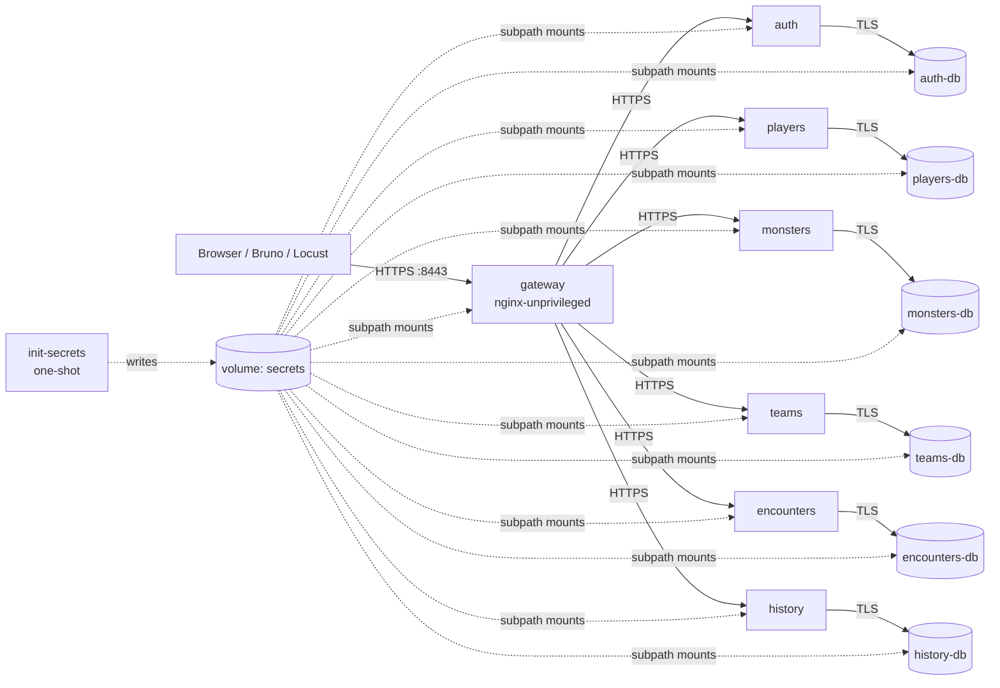

# 02 — Infrastructure

Goal: on a fresh clone, `docker compose up` builds and starts the whole backend over HTTPS, with no manual step and no committed secret.

## Topology



| Container | Image | Internal port | Host port |
|---|---|---|---|
| `init-secrets` | `infra/init-secrets` (Alpine + OpenSSL) | — | — |
| `gateway` | `gateway/` (nginx-unprivileged) | 8443 | **8443** |
| `auth`, `players`, `monsters`, `teams`, `encounters`, `history` | `backend/<svc>/Dockerfile` | 8443 | none (9001–9006 with the test override) |
| `<svc>-db` | postgres alpine | 5432 | none |

---

## INFRA-1 — Maven aggregator and service skeletons · P1

**Depends on:** —

**Description.** Multi-module Maven project in `backend/`, one Quarkus module per service, no shared module.

**Steps**

- [ ] `backend/pom.xml` (packaging `pom`): `groupId it.unipi.ase.tamer`, Java 21 (`maven.compiler.release=21`), `quarkus.platform.version` pinned, Quarkus BOM in `dependencyManagement`, plugin versions pinned (`quarkus-maven-plugin`, `maven-compiler-plugin`, `maven-surefire-plugin`, `maven-failsafe-plugin`, `maven-resources-plugin`), modules list.
- [ ] Generate each module (e.g. `quarkus create app`), then align the pom to inherit from the aggregator.
- [ ] Extensions in every service: `quarkus-rest-jackson`, `quarkus-hibernate-orm-panache`, `quarkus-jdbc-postgresql`, `quarkus-flyway`, `quarkus-smallrye-jwt`, `quarkus-smallrye-openapi`, `quarkus-smallrye-health`, `quarkus-hibernate-validator`, `quarkus-rest-client-jackson`, `quarkus-smallrye-fault-tolerance`. Plus `quarkus-smallrye-jwt-build` in `auth`, `quarkus-scheduler` in `encounters` and `auth` (P2).
- [ ] Test dependencies: `quarkus-junit5`, `rest-assured`, `quarkus-junit5-mockito`, `quarkus-test-security-jwt`.
- [ ] Package skeleton as in [01-conventions.md](01-conventions.md#java-code-structure-per-service).
- [ ] `application.properties` baseline (all services):

  ```properties
  quarkus.application.name=<service>
  quarkus.jackson.property-naming-strategy=SNAKE_CASE
  quarkus.jackson.fail-on-unknown-properties=true
  quarkus.hibernate-orm.database.generation=none
  quarkus.flyway.migrate-at-start=true
  quarkus.smallrye-openapi.info-title=Monster Tamers - <service>
  quarkus.smallrye-openapi.store-schema-directory=target/openapi
  # prod: config from secrets, see INFRA-4
  %prod.quarkus.config.locations=/run/secrets/secrets.properties
  ```

- [ ] Root `.gitignore`: `target/`, `node_modules/`, `.idea/`, `.vscode/`, `*.iml`, `.env`, `docs/tests/bruno/.env`.
- [ ] Fill the versions table in [01-conventions.md](01-conventions.md#versions).

**Done when**

- `mvn -f backend/pom.xml verify` builds all six modules.
- `mvn -f backend/pom.xml -pl players quarkus:dev` starts the service with Dev Services Postgres and `/q/health` is `UP`.

---

## INFRA-2 — Multi-stage, non-root Dockerfiles · P1

**Depends on:** INFRA-1

**Description.** Each service image builds the code inside Docker, so the host needs only Docker. Runtime runs as a non-root user (requirement §6).

**Steps**

- [ ] `backend/<svc>/Dockerfile`, build context `backend/`:

  ```dockerfile
  # build stage
  FROM maven:<pinned>-eclipse-temurin-21 AS build
  WORKDIR /src
  COPY pom.xml .
  COPY auth/pom.xml auth/
  COPY players/pom.xml players/
  # ... all module poms (aggregator needs them)
  RUN mvn -B -q -pl <svc> -am dependency:go-offline
  COPY <svc>/src <svc>/src
  COPY monsters/seed monsters/seed          # only in monsters (seed + images)
  RUN mvn -B -pl <svc> -am package -DskipTests

  # runtime stage
  FROM registry.access.redhat.com/ubi9/openjdk-21-runtime:<pinned>
  COPY --from=build --chown=185 /src/<svc>/target/quarkus-app/ /deployments/
  USER 185
  EXPOSE 8443
  ENV JAVA_APP_JAR=/deployments/quarkus-run.jar
  ```

- [ ] `backend/.dockerignore`: `**/target`, `**/.idea`, `**/*.iml`.
- [ ] `HEALTHCHECK` is defined in compose (INFRA-6), not in the Dockerfile. Verify the runtime image has `curl` (UBI images ship `curl-minimal`); if not, use a small Java health probe.
- [ ] Tests are skipped in the image build; CI runs them (CI-1).

**Done when**

- `docker build -f backend/auth/Dockerfile backend/` succeeds.
- `docker run --rm --entrypoint id <image>` prints a non-zero uid.

---

## INFRA-3 — Postgres per service, Flyway and seeds · P1

**Depends on:** INFRA-1, INFRA-4

**Description.** One Postgres container per service, reachable only on the Docker network, with TLS. Schema managed by Flyway.

**Steps**

- [ ] Datasource (prod profile) from config written by INFRA-4:

  ```properties
  %prod.quarkus.datasource.jdbc.url=jdbc:postgresql://<svc>-db:5432/<svc>?sslmode=verify-full&sslrootcert=/run/secrets/ca.crt
  %prod.quarkus.datasource.username=<svc>_app
  # quarkus.datasource.password comes from /run/secrets/secrets.properties
  ```

- [ ] Postgres container runs as user `postgres` (`user: "70:70"` on the alpine image). The image's data directory is already owned by `postgres`, so a fresh named volume inherits that ownership.
- [ ] Postgres TLS: the server key must be `0600` and owned by the running user, so the container command copies it first:

  ```yaml
  command: >
    sh -c "cp /run/secrets/tls/server.key /tmp/server.key && chmod 600 /tmp/server.key &&
           exec docker-entrypoint.sh postgres -c ssl=on
           -c ssl_cert_file=/run/secrets/tls/server.crt -c ssl_key_file=/tmp/server.key"
  ```

- [ ] Environment: `POSTGRES_DB=<svc>`, `POSTGRES_USER=<svc>_app`, `POSTGRES_PASSWORD_FILE=/run/secrets/db-password`.
- [ ] Migration `V1__init.sql` per service (content defined in each area file).
- [ ] `monsters` seed: Java-based Flyway migration `V2__seed_catalogue` (class `db.migration.V2__seed_catalogue` implementing `JavaMigration`) reading `seed/monsters.json`, `abilities.json`, `elements.json` from the classpath. The seed JSON is copied into resources at build time by `maven-resources-plugin` from `backend/monsters/seed/` (no duplication in git).
- [ ] `encounters` seed: same approach for `backend/encounters/seed/encounter_templates.json` (EN-1).
- [ ] Tests use Dev Services (no TLS, `%test` profile).
- [ ] P2: custom `pg_hba.conf` with `hostssl` only, so non-TLS connections are refused server-side.

**Done when**

- Each service creates its schema at startup; `monsters` has 100 monsters, 28 abilities, 7 elements.
- JDBC connection works with `sslmode=verify-full`.

---

## INFRA-4 — Secrets and certificates generated at first start · P1

**Depends on:** —

**Description.** A one-shot `init-secrets` container generates every secret into a named volume `secrets`, only if missing. Each container mounts **only its own sub-directory** of the volume (compose `volume.subpath`, requires Docker Compose ≥ 2.30). Nothing is committed (P-04).

**Generated layout** (inside the volume):

```
ca/ca.crt, ca/ca.key                     local CA (ca.key stays here, mounted nowhere)
gateway/ca.crt, gateway/tls/server.{crt,key}          CN/SAN: localhost, 127.0.0.1
<svc>/ca.crt                             for each of the 6 services
<svc>/tls/server.{crt,key}               SAN: <svc>, localhost
<svc>/jwt-public.pem                     all services
auth/jwt-private.pem                     only auth (PKCS#8, RSA 2048)
<svc>/secrets.properties                 datasource password, service client secret, ...
<svc>-db/ca.crt, <svc>-db/tls/server.{crt,key}        SAN: <svc>-db
<svc>-db/db-password                     same value as in <svc>/secrets.properties
tests/client.env                         test client secret (used only with the test override)
```

`secrets.properties` content:

| Service | Keys |
|---|---|
| all six | `quarkus.datasource.password`, `tamer.service-client.id=<svc>`, `tamer.service-client.secret` |
| `auth` | `tamer.service-clients.<svc>=<secret>` for each caller (`players`, `teams`, `encounters`, `tests`), P2: `tamer.crypto.username-enc-key`, `tamer.crypto.username-hmac-key` |

**Steps**

- [ ] `infra/init-secrets/Dockerfile`: pinned Alpine, `apk add --no-cache openssl`, `RUN mkdir /secrets && chown 10001 /secrets`, `USER 10001`, entrypoint `init-secrets.sh`. Because `/secrets` is owned by uid 10001 in the image, the fresh named volume inherits that ownership and the script can write without root.
- [ ] `init-secrets.sh` (POSIX sh, `set -eu`): skip everything if `/secrets/.done` exists; otherwise generate CA (RSA 4096, 10 years), leaf certificates (RSA 2048, SAN extension, signed by the CA), JWT key pair, random secrets (`openssl rand -base64 32`), write files, `chmod 0644` (isolation comes from subpath mounts: each container sees only its directory), touch `.done`.
- [ ] Mount example in compose:

  ```yaml
  volumes:
    - type: volume
      source: secrets
      target: /run/secrets
      read_only: true
      volume:
        subpath: auth
  ```

- [ ] Quarkus TLS (prod profile), all services:

  ```properties
  %prod.quarkus.http.ssl-port=8443
  %prod.quarkus.http.insecure-requests=disabled
  %prod.quarkus.tls.key-store.pem.0.cert=/run/secrets/tls/server.crt
  %prod.quarkus.tls.key-store.pem.0.key=/run/secrets/tls/server.key
  %prod.quarkus.tls.internal.trust-store.pem.certs=/run/secrets/ca.crt
  %prod.quarkus.rest-client.<name>.tls-configuration-name=internal
  ```

- [ ] Document in the README how to regenerate everything: `docker compose down -v` (removes data too) or remove only the `secrets` volume.

**Done when**

- On a fresh clone, `docker compose up` creates the secrets and every service starts with HTTPS.
- `git status` never shows a key or certificate; `jwt-private.pem` is visible only inside `auth`.

---

## INFRA-5 — Nginx gateway · P1

**Depends on:** INFRA-4

**Description.** Single entry point. Terminates client HTTPS, re-encrypts to the services (verifying their certificate against the local CA), blocks internal paths, applies CORS and rate limiting. It does **not** serve the frontend.

**Steps**

- [ ] `gateway/Dockerfile`: `FROM nginxinc/nginx-unprivileged:<pinned>`, copy `templates/default.conf.template` to `/etc/nginx/templates/` (the image runs `envsubst` on templates at start).
- [ ] Server block: `listen 8443 ssl;`, `ssl_protocols TLSv1.2 TLSv1.3;`, certificate from `/run/secrets/tls/`, `server_tokens off;`, `client_max_body_size 16k;`.
- [ ] Upstreams over HTTPS:

  ```nginx
  proxy_ssl_verify on;
  proxy_ssl_trusted_certificate /run/secrets/ca.crt;
  proxy_ssl_server_name on;
  proxy_set_header X-Request-Id $request_id;
  proxy_set_header X-Forwarded-For $proxy_add_x_forwarded_for;
  ```

  Each `location` sets `proxy_ssl_name <svc>;` and `proxy_pass https://<svc>:8443;`.
- [ ] Routing:

  | Location | Upstream |
  |---|---|
  | `/api/auth/` | auth |
  | `/api/players/` | players |
  | `/api/monsters`, `/api/abilities`, `/api/elements`, `/api/collection`, `/images/` | monsters |
  | `/api/teams` | teams |
  | `/api/encounters`, `/api/runs`, `/api/battles` | encounters |
  | `/api/history` | history |
  | `= /health` | `return 200 'ok'` (used to accept the self-signed cert in the browser) |
  | `/internal/`, `/q/`, anything else | `return 404` with JSON body `{"error":"NOT_FOUND",...}` |

- [ ] CORS: allowed origins `http://localhost:5173` (Vite dev) and `http://localhost:4173` (Vite preview), matched with a `map $http_origin $cors_origin { … }` so only listed origins are echoed in `Access-Control-Allow-Origin`; methods `GET, POST, PUT, PATCH, DELETE, OPTIONS`; headers `Authorization, Content-Type, X-Request-Id`; answer `OPTIONS` preflight with `204`. Never `*`.
- [ ] Rate limiting: `limit_req_zone $binary_remote_addr zone=auth:10m rate=${AUTH_RATE_LIMIT};` (default `10r/m`, burst 5, `limit_req_status 429`) on `/api/auth/token` and `/api/auth/register`. The test override raises it for Locust.
- [ ] Security headers: `Strict-Transport-Security "max-age=31536000"`, `X-Content-Type-Options nosniff`, `X-Frame-Options DENY`, `Referrer-Policy no-referrer`.
- [ ] HTTP port: none exposed (only 8443), so there is no plaintext listener at all.

**Done when**

- `curl --cacert <ca> https://localhost:8443/api/monsters` reaches `monsters` (401 without token).
- `/internal/...` and `/q/health` return 404 through the gateway.
- The 12th login in a minute from the same IP returns 429.

---

## INFRA-6 — docker-compose.yml · P1

**Depends on:** INFRA-2, INFRA-3, INFRA-4, INFRA-5

**Description.** `docker compose up` builds and starts everything. Only the gateway publishes a port.

**Steps**

- [ ] Services: `init-secrets`, `gateway`, six services, six databases.
- [ ] Networks: `backend` (internal, all containers). The gateway also joins a default network to publish `8443:8443`.
- [ ] Volumes: `secrets`, `auth-db-data`, `players-db-data`, `monsters-db-data`, `teams-db-data`, `encounters-db-data`, `history-db-data`.
- [ ] Health checks:
  - DB: `pg_isready -U <svc>_app -d <svc>`
  - service: `curl -fsk https://localhost:8443/q/health/ready` (or the probe chosen in INFRA-2)
  - gateway: `curl -fsk https://localhost:8443/health`
- [ ] Startup order with `depends_on`:
  - every container → `init-secrets: service_completed_successfully`
  - service → its DB `service_healthy`
  - gateway → all services `service_healthy`
  - no service depends on another service (they tolerate missing dependencies via retries/circuit breaker), avoiding start-up deadlocks.
- [ ] Environment per service: `QUARKUS_PROFILE=prod`, `TAMER_<CALLEE>_URL=https://<callee>:8443` for each REST client, `TAMER_AUTH_URL` for the token endpoint.
- [ ] `user:` set for every container (`10001` init, `70:70` Postgres, `185` services; nginx-unprivileged already non-root).
- [ ] `security_opt: ["no-new-privileges:true"]` and `cap_drop: [ALL]` on every container. All of them run as non-root from the start, so no capability is needed; verify each one still starts.
- [ ] `docker-compose.test.yml` (used by TEST-1): publishes `9001–9006 → 8443` for the six services, sets `TAMER_TEST_CLIENT_ENABLED=true` on `auth`, raises `AUTH_RATE_LIMIT`.
- [ ] `restart: unless-stopped` for services and DBs.

**Done when**

- `docker compose up --build` on a fresh clone: all containers `healthy`, `init-secrets` exited 0.
- `docker compose down && docker compose up` keeps all data.
- `docker compose ps` shows only `0.0.0.0:8443` published.

---

## INFRA-7 — Security and cross-cutting commons · P1

**Depends on:** INFRA-1, INFRA-4. Reference implementation in `players`, then copied.

**Description.** Everything every service needs in the same way: JWT verification, roles, service-token client, error mapping, request id.

**Steps**

- [ ] JWT verification:

  ```properties
  mp.jwt.verify.publickey.location=/run/secrets/jwt-public.pem
  mp.jwt.verify.issuer=tamer-auth
  mp.jwt.verify.audiences=tamer-api,tamer-internal
  smallrye.jwt.path.groups=groups
  ```

- [ ] `security/CurrentPlayer` request-scoped bean: `UUID id()` from `JsonWebToken.getSubject()`, fails with 401 if missing.
- [ ] `security/ServiceTokenProvider`: `POST ${TAMER_AUTH_URL}/internal/auth/token` with form `grant_type=client_credentials&client_id=…&client_secret=…`; caches the token until 30 s before `expires_in`; thread-safe.
- [ ] `security/ServiceTokenFilter` (`ClientRequestFilter`) registered on all internal REST clients; also forwards `X-Request-Id`.
- [ ] `error/` package as in [01-conventions.md](01-conventions.md#error-format).
- [ ] `RequestIdFilter` (`ContainerRequestFilter`): reads/creates `X-Request-Id`, puts it in the MDC; log format `%d %-5p [%X{request_id}] %c{2.} %s%e%n`.
- [ ] Test profile: `quarkus-test-security-jwt` (`@TestSecurity` + `@JwtSecurity(claims = @Claim(key = "sub", value = "..."))`).
- [ ] A short "how to copy the commons" section in `backend/README.md`.

**Done when**

- Without a token → 401; player token on `/internal/*` → 403; service→service call succeeds with the service token.

---

## INFRA-8 — README quick start · P1

**Depends on:** INFRA-6

**Steps**

- [ ] **Get Started** section in the root `README.md`:
  1. Prerequisites: Docker Engine ≥ 26 with Compose ≥ 2.30, Java 21 + Maven (only for local tests), Node LTS (frontend), Bruno CLI (tests).
  2. `git clone …` and `docker compose up --build`.
  3. Gateway at `https://localhost:8443`; open `https://localhost:8443/health` once and accept the certificate, or export the local CA with `scripts/export-ca.sh` and pass it to curl/Bruno.
  4. Frontend: `cd frontend && npm ci && npm run dev`, open `http://localhost:5173`.
  5. Tests: `mvn -f backend/pom.xml verify`; Bruno (see [10-testing.md](10-testing.md)).
  6. Reset: `docker compose down -v`.
- [ ] `scripts/export-ca.sh`: copies `ca.crt` out of the `secrets` volume with a throw-away container (`docker run --rm -v <project>_secrets:/s:ro alpine cat /s/gateway/ca.crt`).
- [ ] Ports table and troubleshooting (port 8443 busy, certificate warnings, stale volumes).

**Done when**

- A teammate who did not work on infrastructure starts everything from scratch following only the README.
