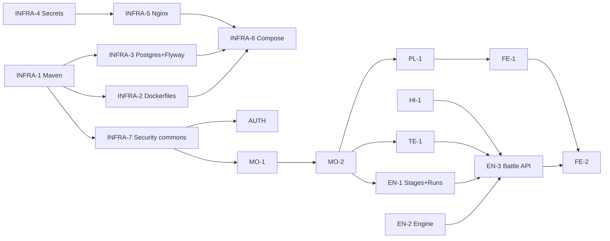

# Monster Tamers — Implementation Plan

This folder is the single reference for implementing the backend, the frontend, the tests and the delivery material. It builds on:

- [`docs/architettura/architettura_backend.md`](../architettura/architettura_backend.md) — architecture and game rules (15/10/2026)
- [`docs/design/area_giocatori_mostri.md`](../design/area_giocatori_mostri.md) — players and monsters data
- [`docs/Monster_Tamer_Functional_Requirements.pdf`](../Monster_Tamer_Functional_Requirements.pdf) — official requirements
- `docs/consegna/Monster_Tamers_Backlog.xlsx` — user stories

Where this plan and older documents disagree, **this plan wins** (see [Changes to the architecture](#changes-to-the-architecture)). The architecture document must be updated accordingly (task DOC-1).

## Files

| File | Content | Issues |
|---|---|---|
| [01-conventions.md](01-conventions.md) | Repository layout, code structure, API/error/pagination format, security and resilience conventions | — |
| [02-infrastructure.md](02-infrastructure.md) | Maven, Dockerfiles, secrets and certificates, Postgres, Nginx, compose | INFRA-1…8 |
| [03-auth.md](03-auth.md) | Accounts, OAuth2 token endpoint, JWT, service tokens | AUTH-1…8 |
| [04-players.md](04-players.md) | Profile, starter pool, current run | PL-1 (+ US-04 in P2) |
| [05-monsters.md](05-monsters.md) | Catalogue, images, collection, levels and XP | MO-1, MO-2 (+ US-13 in P2) |
| [06-teams.md](06-teams.md) | Teams and validation | TE-1 |
| [07-encounters.md](07-encounters.md) | Stage data, runs, battle engine, battle API, run reset | EN-1, EN-2, EN-3 (P1); EN-4…7 (P2) |
| [08-history.md](08-history.md) | Encounter history, integrity | HI-1 (P1), HI-2 (P2) |
| [09-frontend.md](09-frontend.md) | React UI | FE-1, FE-2 (P1), FE-3 (P2) |
| [10-testing.md](10-testing.md) | Unit, component (Bruno), integration, e2e, Locust | TEST-1, TEST-2 (P1), TEST-3, TEST-4 (P2) |
| [11-ci-security.md](11-ci-security.md) | GitHub Actions, Semgrep, Trivy, hardening | CI-1 (P1), CI-2, SEC-1 (P2) |
| [12-docs-delivery.md](12-docs-delivery.md) | Backlog, OpenAPI, report, delivery checklists | DOC-1, DOC-2 |

## Phases

| Phase | Deadline | Scope |
|---|---|---|
| **P1 — Prototype** | 10/11/2026 (optional, feedback only) | All red user stories + green US-07, US-21, US-22. Internal HTTPS. All 8 stages. Simple abilities. CI build + test. Bruno collections for all 6 services |
| **P2 — Final** | 15/12/2026 (mandatory) | Yellow US-05 (complete) and US-25. Refresh token and logout. Encryption at rest. Complex abilities. Robust reset saga and battle expiry sweep. Semgrep + Trivy. Locust. Report. Optional green stories (US-04, US-13) |

Every task in the area files is tagged **P1** or **P2**.

### P1 cut line

P1 is large for four days. If time runs out, finish in this order and move the rest to the days after 10/11 (the prototype is not graded):

1. **Must:** INFRA-1…7, AUTH-1…5, PL-1, MO-1, MO-2, TE-1, EN-1, EN-2 (no abilities), EN-3, HI-1, FE-1, FE-2, README quick start.
2. **Should:** simple abilities in the engine, Bruno collections for the remaining services, e2e collection, CI-1.
3. **Could:** OpenAPI polish, gateway OpenAPI merge.

## Decision log

Decisions taken on 06/11/2026 while preparing this plan. They complement decisions A1–A9 and R1–R20 of the architecture document.

| # | Topic | Decision |
|---|---|---|
| P-01 | Plan scope | P1 prototype + P2 final, in one coherent plan |
| P-02 | Language | **Everything in English**: code, comments, API messages, OpenAPI, this plan. Older Italian documents stay as they are |
| P-03 | Frontend | **Vite + React** (TypeScript, see FE-1), outside docker compose |
| P-04 | Secrets | **Generated at first start** by a one-shot `init-secrets` container: DB passwords, TLS certificates, JWT keys, service client secrets. Nothing secret is committed |
| P-05 | Login API | **OAuth2 token endpoint** `POST /api/auth/token` (form-urlencoded, `grant_type=password` in P1, `refresh_token` in P2). Services use `grant_type=client_credentials` on `POST /internal/auth/token` |
| P-06 | TLS | **HTTPS everywhere from P1**: client→gateway, gateway→service, service→service, service→Postgres. One local CA, one certificate per container |
| P-07 | Gateway port | `https://localhost:8443` |
| P-08 | Stages | **All 8 stages** defined in P1 |
| P-09 | Abilities | **Simple effects in P1**, complex effects in P2 (list in [07-encounters.md](07-encounters.md#abilities)) |
| P-10 | Flee / abandon | **Both in P1**: flee is a battle action; abandon reuses the defeat reset |
| P-11 | Foreign resources | A resource owned by another player returns **404**, never 403 |
| P-12 | Bruno | Component collections for **all 6 services** + integration + e2e |
| P-13 | Test access | `docker-compose.test.yml` override exposes the services on localhost only for tests |
| P-14 | Encryption at rest (P2) | Username encrypted (AES-GCM) with HMAC blind index; refresh tokens stored only as SHA-256 hash |
| P-15 | Security tools (P2) | **Semgrep** (SAST) + **Trivy** (dependencies and images) |
| P-16 | Images | Monster sprites are **public** (no token): `` cannot send a bearer token |
| P-17 | Frontend token storage | **localStorage** (mitigated by CSP and no raw HTML rendering, see FE-1) |
| P-18 | CI in P1 | GitHub Actions with build + tests from P1; security scans added in P2 |
| P-19 | Default display name | `Tamer-<first 6 hex of player_id>`; the username is never copied into `players` (keeps P-14 meaningful) |
| P-20 | Battle robustness in P1 | Lazy recovery: a battle missing from memory is closed as `interrupted`, an idle one as `expired`, when the player next touches the run. Scheduled sweep in P2 |
| P-21 | Bosses | Stage bosses are excluded from wild encounters, so each boss is obtainable only by beating it |

## Changes to the architecture

| Architecture document | This plan |
|---|---|
| `POST /api/auth/login` (JSON) | `POST /api/auth/token` (OAuth2, form-urlencoded) |
| `POST /internal/auth/service-token` | `POST /internal/auth/token` with `grant_type=client_credentials` |
| Nginx serves the static frontend on `/` | Frontend runs outside compose; Nginx only proxies the API, with CORS |
| HTTPS terminated at Nginx | HTTPS on every hop, including Postgres |
| Monster earned at level 1 (old US-12 AC) | Earned at the wild monster's level (already in architecture §8) |
| Ownership violation → 403 (US-05 AC) | → 404 |
| `POST /internal/players` body not specified | `{player_id}`; default display name generated by `players` |
| No endpoint to list monsters by rarity/element internally | `GET /internal/monsters?rarity=&element=` |
| US-20 not mapped to an endpoint | Final response of the battle action + `GET /api/history/{id}` |
| Outcomes: victory, defeat, fled, expired, interrupted | + `abandoned` (battle closed by a run abandon) |
| Catalogue requires authentication (D11) | Still true for JSON endpoints; images are public (P-16) |

## Work order and critical path

**Critical path:** INFRA-1 → INFRA-7 → MO-2 → TE-1 → EN-3 → FE-2. **EN-2 has no dependencies: start it on day one.**

### Suggested split (4 people)

| Person | Day 1 | Day 2 | Day 3 | Day 4 |
|---|---|---|---|---|
| A | INFRA-1, INFRA-7 | AUTH-1…4 | PL-1 | AUTH-5, TEST-1 (auth, players) |
| B | INFRA-4, INFRA-5, INFRA-2, INFRA-3 | INFRA-6, CI-1 | HI-1 | INFRA-8, DOC-1 |
| C | EN-2 (engine) | EN-1 | EN-3 | EN-3, TEST-1 (encounters) |
| D | MO-1 | MO-2 | TE-1, FE-1 | FE-2, TEST-2 |

With 3 people, merge B and D: infrastructure first, then monsters/teams.

## Implementation status

| Date | Done | Notes |
|---|---|---|
| 06/11/2026 | INFRA-1…8, AUTH-1…6 | Implementation notes at the end of [02-infrastructure.md](02-infrastructure.md#implementation-notes-06112026) and [03-auth.md](03-auth.md#implementation-notes-06112026). Registration works end to end only after PL-1 (and MO-2). Shared Bruno setup of TEST-1 (`bruno.json`, environments, `scripts/test-env.sh`) also done |
| 09/11/2026 | EN-1…3, HI-1, FE-1, FE-2 | Engine, encounters service, history service and the React UI. Verified end to end through the gateway with `docker compose up` (register → starters → team → battles → boss → stage 2/3 → defeat → reset → history). Notes in [07-encounters.md](07-encounters.md#tuned-constants) (boss HP ×1.5; late bosses still hard for a commons-only team) |

## Definition of done (every task)

- Code builds with `mvn -f backend/pom.xml verify` (backend) or `npm run build` (frontend).
- Tests listed in the task exist and pass.
- Every new endpoint has OpenAPI annotations and at least one valid and one invalid Bruno request.
- Acceptance criteria of the covered user stories are written in Given/When/Then in [`docs/backlog/acceptance_criteria.md`](../backlog/acceptance_criteria.md) (created by DOC-1).
- No secret, key or certificate committed.
- Conventions in [01-conventions.md](01-conventions.md) respected.

## Implementation handoff (09/11/2026)

The P1 implementation of `04-players`, `05-monsters` and `06-teams` has been added (PL-1, MO-1/2, TE-1), including API code, Flyway migrations, unit tests, Bruno source collections and acceptance criteria. See [IMPLEMENTATION_HANDOFF_04_06.md](IMPLEMENTATION_HANDOFF_04_06.md) for contracts expected by `07-encounters`, validation performed, and the pending full Maven/Docker verification.
